<div align="center" style="font-family: Arial, Helvetica, sans-serif; max-width: 900px; margin: 0 auto; background-color: #FFFFFF; color: #0C233F; border: 1px solid #E2E8F0; border-radius: 8px;">

<div style="height: 6px; background-color: #E22726; border-radius: 8px 8px 0 0;"></div>

<table align="center">
  <tr>
    <td align="center" valign="middle"></td>
    <td width="50"></td>
    <td align="center" valign="middle"></td>
  </tr>
</table>

<p style="color: #0C233F; font-size: 20px; font-weight: bold; margin: 8px 0 2px;">ESCUELA POLITÉCNICA NACIONAL</p>
<p style="color: #475569; font-size: 16px; margin: 0;">Facultad de Ingeniería de Sistemas</p>
<p style="color: #475569; font-size: 14px; margin: 2px 0 0;">Carrera de Ingeniería de Software</p>

<p style="color: #E22726; font-size: 13px; font-weight: bold; letter-spacing: 2px; margin: 26px 0 0;">PROYECTO PRIMER BIMESTRE</p>

<hr width="12%" style="height: 3px; background-color: #F4BC47; border: 0;">

<h1 align="center" style="color: #0C233F; font-size: 34px; margin: 10px 0 4px; border: 0;">BI Tienda "Mariana"</h1>

<p style="color: #475569; font-size: 15px; margin: 0 0 22px;">Solución de Business Intelligence: proceso ETL en Pentaho, modelo dimensional en PostgreSQL y dashboard en Power BI</p>

<table align="center">
  <tr><td align="right"><b>Materia:</b></td><td align="left">Business Intelligence</td></tr>
  <tr><td align="right"><b>Paralelo:</b></td><td align="left">GR2SW</td></tr>
  <tr><td align="right"><b>Periodo:</b></td><td align="left">2026-B</td></tr>
  <tr><td align="right"><b>Docente:</b></td><td align="left">Diana Martínez</td></tr>
  <tr><td align="right"><b>Grupo:</b></td><td align="left">F</td></tr>
</table>

<br>

<table align="center">
  <tr>
    <td align="center" style="background-color: #F7F5E9; color: #334155; border-left: 4px solid #F4BC47; padding: 16px 28px; line-height: 1.9;">
      <b style="color: #0C233F; letter-spacing: 1px;">INTEGRANTES</b><br>
      Guamán Maza Jonathan Steven<br>
      Jarrin Román Helen Scarleth<br>
      Maldonado Simbaña Shirley Estefani<br>
      Sigcha Diaz Christian David
    </td>
  </tr>
</table>

<br>

<div style="height: 4px; background-color: #F4BC47; border-radius: 0 0 8px 8px;"></div>

</div>

<br>

<a id="indice"></a>

## Índice general

- [Índice de figuras](#lof)
- [Índice de tablas](#lot)
- [Resumen](#resumen)
- [I. Introducción](#intro)
  - [A. Descripción del negocio](#intro-negocio)
  - [B. Problema identificado](#intro-problema)
  - [C. Preguntas de negocio](#intro-preguntas)
- [II. Objetivos](#objetivos)
  - [A. Objetivo general](#obj-general)
  - [B. Objetivos específicos](#obj-especificos)
  - [C. Entregables](#obj-entregables)
- [III. Fuente de datos](#fuente)
  - [A. Origen y obtención](#fuente-origen)
  - [B. Estructura del Excel](#fuente-estructura)
  - [C. Autorización y protección de datos](#fuente-autorizacion)
  - [D. Cobertura temporal y limitaciones](#fuente-limitaciones)
- [IV. Diseño dimensional](#diseno)
  - [A. Proceso de negocio y metodología](#dis-proceso)
  - [B. Granularidad](#dis-grano)
  - [C. Dimensiones](#dis-dimensiones)
  - [D. Bus Matrix](#dis-bus)
  - [E. Justificación del esquema](#dis-justificacion)
  - [F. Convenciones de nombres](#dis-nombres)
- [V. Modelo dimensional en PostgreSQL](#modelo)
  - [A. Esquemas staging y dw](#mod-esquemas)
  - [B. Tablas, claves primarias y foráneas](#mod-tablas)
  - [C. Registros especiales (−1)](#mod-especiales)
  - [D. Diagrama del modelo](#mod-diagrama)
- [VI. Proceso ETL en Pentaho](#etl)
  - [A. Arquitectura y conexión](#etl-arquitectura)
  - [B. Staging: 01_staging](#etl-staging)
  - [C. Dimensión tiempo: 02_dim_tiempo](#etl-tiempo)
  - [D. Dimensión categoría: 03_dim_categoria](#etl-categoria)
  - [E. Dimensión proveedor: 04_dim_proveedor](#etl-proveedor)
  - [F. Dimensión producto de compra: 05_dim_producto_compra](#etl-prodcompra)
  - [G. Dimensión producto de venta: 06_dim_producto_venta](#etl-prodventa)
  - [H. Hecho de compras: 07_fact_compras](#etl-factcompras)
  - [I. Hecho de ventas: 08_fact_ventas](#etl-factventas)
  - [J. Job orquestador](#etl-job)
  - [K. Estrategia de carga](#etl-carga)
  - [L. Validación de la carga](#etl-validacion)
- [VII. Problemas encontrados](#problemas)
  - [A. En los datos](#prob-datos)
  - [B. Durante la implementación](#prob-impl)
- [VIII. Consultas SQL y respuestas](#consultas)
  - [A. P1. Productos con más ingresos y más frecuencia de venta](#p1)
  - [B. P2. Categorías que más aportan a las ventas](#p2)
  - [C. P3. Ventas según el día de la semana](#p3)
  - [D. P4. Gasto por proveedor y concentración de compras](#p4)
  - [E. P5. Evolución mensual de las compras (2025)](#p5)
  - [F. P6. Parte de lo facturado que no es mercadería](#p6)
  - [G. P7. Compras frente a ventas por categoría](#p7)
- [IX. Dashboard en Power BI](#powerbi)
  - [A. Página 1: Análisis de Facturas y Compras](#pbi-p1)
  - [B. Página 2: Muestra de Ventas y Comparativa](#pbi-p2)
  - [C. Cobertura de las preguntas de negocio](#pbi-cobertura)
- [X. Análisis OLAP](#olap)
- [XI. Insights y recomendaciones](#insights)
- [XII. Conclusiones](#conclusiones)
- [Referencias bibliográficas](#referencias)
- [Declaración de uso de inteligencia artificial](#ia)
- [Anexos](#anexos)
  - [A. Estructura del repositorio](#anexo-a)
  - [B. Cómo reproducir](#anexo-b)
  - [C. Integrantes](#anexo-c)

<a id="lof"></a>

## Índice de figuras

- [Fig. 1.](#fig-crear) Creación de los esquemas y tablas con sql/01_ddl.sql en pgAdmin.
- [Fig. 2.](#fig-reiniciar) Ejecución de sql/02_reiniciar_dw.sql: vaciado de tablas e inserción de los registros −1.
- [Fig. 3.](#fig-diagrama) Diagrama entidad-relación del esquema dw generado desde pgAdmin (ERD Tool).
- [Fig. 4.](#fig-mermaid) Modelo constelación en Mermaid: dos hechos, dimensiones compartidas y copo de nieve parcial en categoría.
- [Fig. 5.](#fig-conexion) Prueba exitosa de la conexión conn_mariana entre Pentaho y PostgreSQL.
- [Fig. 6.](#fig-ejstaging) Ejecución de la transformación 01_staging en Spoon.
- [Fig. 7.](#fig-stgres) Métricas de pasos de 01_staging: filas leídas y escritas por hoja (Días venta 10, Productos 743, Facturas 478, Ventas 1.214, Detalle 1.448, Proveedores 47, Categorías 17).
- [Fig. 8.](#fig-ejtiempo) Ejecución de la transformación 02_dim_tiempo.
- [Fig. 9.](#fig-ejcategoria) Ejecución de la transformación 03_dim_categoria.
- [Fig. 10.](#fig-ejproveedor) Ejecución de la transformación 04_dim_proveedor (47 filas leídas y escritas).
- [Fig. 11.](#fig-ejprodcompra) Ejecución de la transformación 05_dim_producto_compra (743 filas leídas, 604 escritas).
- [Fig. 12.](#fig-ejprodventa) Ejecución de la transformación 06_dim_producto_venta.
- [Fig. 13.](#fig-ejfactcompras) Ejecución de la transformación 07_fact_compras.
- [Fig. 14.](#fig-ejfactventas) Ejecución de la transformación 08_fact_ventas.
- [Fig. 15.](#fig-job) Diseño del Job Job_Tienda_Mariana.
- [Fig. 16.](#fig-ejjob) Ejecución completa del Job: todos los pasos finalizan con éxito.
- [Fig. 17.](#fig-val1) Validación 1: conteo de filas de dimensiones y hechos, y hechos con clave −1.
- [Fig. 18.](#fig-val2) Validación 2: precio unitario máximo en fact_compras tras la corrección.
- [Fig. 19.](#fig-val3) Validación 3: las tarifas de IVA quedaron en una sola escala (15 y 0).
- [Fig. 20.](#fig-val4) Validación 4: líneas de compra marcadas como bonificación.
- [Fig. 21.](#fig-val5) Validación 5: ningún RUC con longitud distinta de 13 caracteres.
- [Fig. 22.](#fig-p1) Resultado de P1: diez productos con mayor ingreso en la muestra de ventas.
- [Fig. 23.](#fig-p2) Resultado de P2: ventas y participación porcentual por categoría (16 categorías).
- [Fig. 24.](#fig-p3) Resultado de P3: total y promedio diario de ventas por día de la semana.
- [Fig. 25.](#fig-p4) Resultado de P4: diez principales proveedores de mercadería.
- [Fig. 26.](#fig-p5) Resultado de P5: compras mensuales.
- [Fig. 27.](#fig-p6) Resultado de P6: composición del gasto facturado por categoría de gasto.
- [Fig. 28.](#fig-p7) Resultado de P7: porcentaje de compras y de ventas por categoría (16 filas; se muestran las primeras ocho).
- [Fig. 29.](#fig-dash1) Página 1 del dashboard: Análisis de Facturas y Compras.
- [Fig. 30.](#fig-dash2) Página 2 del dashboard: Muestra de Ventas y Comparativa.

<a id="lot"></a>

## Índice de tablas

- [TABLE I.](#tab-preguntas) Preguntas de negocio planteadas
- [TABLE II.](#tab-entregables) Entregables del proyecto y su ubicación en el repositorio
- [TABLE III.](#tab-hojas) Hojas del Excel de origen y tablas de staging
- [TABLE IV.](#tab-grano) Granularidad y medidas de cada tabla de hechos
- [TABLE V.](#tab-dimensiones) Dimensiones del modelo
- [TABLE VI.](#tab-bus) Bus Matrix: procesos de negocio y dimensiones
- [TABLE VII.](#tab-nombres) Convenciones de nombres utilizadas
- [TABLE VIII.](#tab-pkfk) Claves primarias y foráneas del modelo
- [TABLE IX.](#tab-herramientas) Herramientas y versiones
- [TABLE X.](#tab-transformaciones) Resumen de transformaciones del ETL
- [TABLE XI.](#tab-validacion) Conteo de filas del DW tras la carga
- [TABLE XII.](#tab-reglas) Validación de las reglas de limpieza
- [TABLE XIII.](#tab-probdatos) Problemas encontrados en los datos y tratamiento aplicado
- [TABLE XIV.](#tab-probimpl) Problemas encontrados durante la implementación y solución
- [TABLE XV.](#tab-r1) P1. Top 10 de productos por ingreso
- [TABLE XVI.](#tab-r2) P2. Ventas por categoría (ocho de mayor aporte)
- [TABLE XVII.](#tab-r3) P3. Ventas por día de la semana
- [TABLE XVIII.](#tab-r4) P4. Top 10 de proveedores de mercadería
- [TABLE XIX.](#tab-r5) P5. Compras mensuales de 2025
- [TABLE XX.](#tab-r6) P6. Composición de lo facturado
- [TABLE XXI.](#tab-r7) P7. Participación en compras y en ventas por categoría (primeras ocho)
- [TABLE XXII.](#tab-cobertura) Visuales del dashboard y preguntas de negocio que responden
- [TABLE XXIII.](#tab-insights) Hallazgos, evidencia y recomendaciones

---

<a id="resumen"></a>

## Resumen

**Resumen**—Este informe documenta una solución de Business Intelligence aplicada a la tienda de barrio "Mariana" (La Primavera, Ibarra), un negocio que no registra sus ventas de forma sistemática y controla su inventario por observación. A partir de facturas electrónicas de compra y de una muestra de ventas, ambas transcritas a una hoja de cálculo con autorización verbal de la propietaria, se construyó un proceso ETL en Pentaho Data Integration que carga un modelo dimensional en PostgreSQL 17. El modelo es una constelación con dos tablas de hechos (`fact_compras` y `fact_ventas`), dimensiones compartidas (`dim_tiempo`, `dim_categoria`) y un copo de nieve parcial entre productos y categorías. Se plantearon siete preguntas de negocio, respondidas con consultas SQL, y se elaboró un dashboard en Power BI conectado a la base de datos. Los resultados muestran que el 90,5 % de lo facturado corresponde a mercadería, que un solo proveedor concentra el 17,3 % de las compras de mercadería, que las compras de 2025 crecieron de forma sostenida hasta diciembre y que la estructura de compras por categoría difiere de la de ventas. El informe cierra con recomendaciones para el negocio y las limitaciones de los datos.

**Términos de indexación**—Business Intelligence, Data Warehouse, modelado dimensional, esquema constelación, ETL, Pentaho, PostgreSQL, Power BI, OLAP.

---

<a id="intro"></a>

## I. Introducción

<a id="intro-negocio"></a>

### A. Descripción del negocio

"Mariana" es una tienda de barrio con aproximadamente 15 años de funcionamiento, ubicada en La Primavera, Ibarra. Atiende de 06:00 a 22:00 y está administrada y atendida directamente por su propietaria. Ofrece alimentos y productos de primera necesidad, bebidas, snacks y dulces, productos de higiene y limpieza, papelería, artículos varios y comida para mascotas. Sus clientes son personas que compran para sus necesidades diarias. Recibe productos de proveedores y del mercado mayorista, vende al precio marcado y acepta pagos en efectivo, DeUna y fiado.

<a id="intro-problema"></a>

### B. Problema identificado

La información disponible se limita a las facturas de compras a proveedores y a la experiencia de la propietaria para controlar las existencias. Las ventas no se registran de forma sistemática, no se conoce con exactitud cuáles son los productos más vendidos, el inventario se controla por observación y resulta difícil analizar las ventas y planificar las compras con datos organizados. Un enfoque de Business Intelligence permite transformar estos datos operativos en información para la toma de decisiones [1], [10].

<a id="intro-preguntas"></a>

### C. Preguntas de negocio

<a id="tab-preguntas"></a>
<p align="center"><b>TABLE I</b><br>PREGUNTAS DE NEGOCIO PLANTEADAS</p>

| N.º | Pregunta de negocio | Proceso |
|---|---|---|
| P1 | ¿Qué productos generan más ingresos y cuáles se venden con más frecuencia? | Ventas |
| P2 | ¿Qué categorías aportan más a las ventas? | Ventas |
| P3 | ¿Cómo varían las ventas según el día de la semana? | Ventas |
| P4 | ¿Cuánto se gasta por proveedor y qué tan concentradas están las compras? | Compras |
| P5 | ¿Cómo evoluciona el gasto en compras mes a mes? | Compras |
| P6 | ¿Qué parte de lo facturado a nombre de la tienda no es mercadería? | Compras |
| P7 | ¿Las categorías en las que más se gasta son las que más se venden? | Compras y ventas |

---

<a id="objetivos"></a>

## II. Objetivos

<a id="obj-general"></a>

### A. Objetivo general

Desarrollar una solución de Business Intelligence para la tienda de barrio "Mariana", utilizando datos reales autorizados, mediante un proceso ETL en Pentaho, un modelo dimensional implementado en PostgreSQL, un dashboard en Power BI y análisis OLAP, que responda preguntas del negocio y apoye la toma de decisiones.

<a id="obj-especificos"></a>

### B. Objetivos específicos

- Describir el negocio, el problema de información y las fuentes de datos disponibles.
- Diseñar un modelo dimensional (granularidad, medidas, dimensiones y Bus Matrix) y justificar el esquema elegido.
- Implementar el modelo en PostgreSQL con tablas de hechos, dimensiones, claves primarias y foráneas.
- Construir un proceso ETL en Pentaho (transformaciones y Job) que extraiga, transforme y cargue los datos.
- Validar la carga y documentar los problemas encontrados en los datos y durante la implementación.
- Responder las preguntas de negocio mediante consultas SQL y visualizarlas en un dashboard de Power BI.
- Formular insights y recomendaciones para la propietaria del negocio.

<a id="obj-entregables"></a>

### C. Entregables

<a id="tab-entregables"></a>
<p align="center"><b>TABLE II</b><br>ENTREGABLES DEL PROYECTO Y SU UBICACIÓN EN EL REPOSITORIO</p>

| Entregable | Ubicación / estado |
|---|---|
| Modelo dimensional en PostgreSQL (hechos, dimensiones, PK y FK) | [`sql/01_ddl.sql`](sql/01_ddl.sql), [`sql/02_reiniciar_dw.sql`](sql/02_reiniciar_dw.sql) |
| Proceso ETL en Pentaho (transformaciones y Job) | [`pentaho/`](pentaho/) |
| Validación de la carga | [`sql/03_validacion.sql`](sql/03_validacion.sql) |
| Consultas SQL de las preguntas de negocio | [`sql/04_preguntas.sql`](sql/04_preguntas.sql) |
| Dashboard en Power BI conectado a PostgreSQL | [enlace pendiente: dashboard de Power BI conectado a PostgreSQL] |
| Análisis OLAP | [pendiente: análisis OLAP] |
| Informe final | Este documento (`README.md`) |

---

<a id="fuente"></a>

## III. Fuente de datos

<a id="fuente-origen"></a>

### A. Origen y obtención

Los datos provienen de facturas electrónicas de compra en formato PDF emitidas a nombre de la tienda. Esa información se transcribió manualmente a un archivo de Excel de siete hojas, que Pentaho lee para cargarlo al área de preparación (*staging*). Las ventas corresponden a una muestra registrada en la hoja *Días venta* y *Ventas*, que contiene 10 días de venta.

<a id="fuente-estructura"></a>

### B. Estructura del Excel

<a id="tab-hojas"></a>
<p align="center"><b>TABLE III</b><br>HOJAS DEL EXCEL DE ORIGEN Y TABLAS DE STAGING</p>

| Hoja | Filas | Tabla en staging | Contenido principal |
|---|---:|---|---|
| Días venta | 10 | `staging.stg_dias_venta` | Identificador y fecha de cada día de la muestra |
| Productos | 743 | `staging.stg_productos` | Código, descripción, proveedor y categoría del producto comprado |
| Facturas | 478 | `staging.stg_facturas` | Cabecera de cada factura: proveedor, fechas, subtotales, IVA, forma de pago |
| Ventas | 1.214 | `staging.stg_ventas` | Producto, cantidad, medida, valor, producto normalizado y categoría |
| Detalle | 1.448 | `staging.stg_detalle` | Líneas de factura: producto, cantidad, precio, descuento, subtotal e IVA |
| Proveedores | 47 | `staging.stg_proveedores` | RUC, razón social, categoría de gasto y marca de mercadería |
| Categorías | 17 | `staging.stg_categorias` | Catálogo de categorías de producto |

<a id="fuente-autorizacion"></a>

### C. Autorización y protección de datos

Los datos son reales y la propietaria de la tienda autorizó verbalmente su uso con fines académicos. Debido a que las facturas contienen datos de identificación, el archivo de Excel de origen no se publica en este repositorio, en atención a la normativa ecuatoriana de protección de datos personales [9]. Por la misma razón el repositorio no incluye los archivos que contienen la totalidad de los datos cargados.

<a id="fuente-limitaciones"></a>

### D. Cobertura temporal y limitaciones

- **Compras:** las facturas corresponden a los años 2025 y 2026. El análisis de la evolución mensual (P5) se realiza sobre 2025.
- **Ventas:** son una muestra de 10 días, no un registro continuo. Por eso las ventas se comparan por promedio diario (P3) y por porcentajes (P7), no por montos absolutos frente a las compras.
- **Transcripción manual:** al pasar las facturas de PDF a Excel existe riesgo de errores de digitación; varios se corrigen en el ETL (Sección VI).
- **Forma de pago:** el negocio acepta efectivo, DeUna y fiado, pero solo las facturas de compra registran la forma de pago; los datos de ventas no la incluyen.
- **Autorización:** fue verbal, no escrita.

---

<a id="diseno"></a>

## IV. Diseño dimensional

<a id="dis-proceso"></a>

### A. Proceso de negocio y metodología

El diseño sigue las decisiones del modelado dimensional de Kimball: elegir el proceso de negocio, declarar la granularidad, elegir las dimensiones e identificar las medidas [2], [10]. Se identificaron dos procesos: las **compras** a proveedores (facturas) y las **ventas** de la tienda. Como son dos procesos con dimensiones comunes, el esquema resultante es una **constelación de hechos** [1].

<a id="dis-grano"></a>

### B. Granularidad

<a id="tab-grano"></a>
<p align="center"><b>TABLE IV</b><br>GRANULARIDAD Y MEDIDAS DE CADA TABLA DE HECHOS</p>

| Tabla de hechos | Granularidad (una fila representa…) | Medidas |
|---|---|---|
| `fact_compras` | una línea de detalle de una factura de compra: un producto comprado a un proveedor en una fecha | `cantidad`, `precio_unitario`, `descuento`, `subtotal`, `tarifa_iva_pct`, `iva`, `total`, `es_bonificacion` |
| `fact_ventas` | un registro de venta: un producto vendido en un día de la muestra | `cantidad`, `medida`, `valor`, `precio_unitario` |

La granularidad se declaró antes de elegir las medidas y se mantiene consistente dentro de cada tabla de hechos. La unicidad se garantiza con `UNIQUE (proveedor_key, numero_factura, linea)` en compras y con `id_venta UNIQUE` en ventas. En `fact_ventas`, `cantidad` mezcla unidades de medida distintas (libras, unidades, paquetes), por lo que no es sumable entre productos; la medida principal de análisis es `valor`.

<a id="dis-dimensiones"></a>

### C. Dimensiones

<a id="tab-dimensiones"></a>
<p align="center"><b>TABLE V</b><br>DIMENSIONES DEL MODELO</p>

| Dimensión | Clave | Atributos | Tipo | Filas |
|---|---|---|---|---:|
| `dim_tiempo` | `tiempo_key` (AAAAMMDD) | `fecha`, `anio`, `trimestre`, `mes`, `nombre_mes`, `dia`, `dia_semana`, `nombre_dia`, `es_fin_semana` | Conformada (compras y ventas) | 730 + 1 |
| `dim_categoria` | `categoria_key` | `id_categoria`, `nombre_categoria`, `aparece_en` | Conformada, nivel superior del copo de nieve | 17 + 1 |
| `dim_proveedor` | `proveedor_key` | `ruc`, `razon_social`, `nombre_comercial`, `regimen`, `obligado_contabilidad`, `categoria_gasto`, `es_mercaderia` | Específica de compras | 47 + 1 |
| `dim_producto_compra` | `producto_compra_key` | `codigo_producto`, `descripcion`, `categoria_key` (FK) | Específica de compras | 604 + 1 |
| `dim_producto_venta` | `producto_venta_key` | `nombre_producto`, `categoria_key` (FK) | Específica de ventas | 395 + 1 |

*Nota.* El "+ 1" corresponde al registro especial con clave −1 ("Desconocido"). `numero_factura` se conserva en `fact_compras` como **dimensión degenerada**, porque es un identificador de negocio sin atributos descriptivos que justifiquen una tabla propia [10].

Decisiones aplicadas de las buenas prácticas de modelado [10]:

- **Claves sustitutas:** todas las dimensiones usan una clave `*_key` generada por el DW y conservan la clave natural (`ruc`, `codigo_producto`, `id_categoria`) para trazabilidad. `dim_tiempo` usa una clave inteligente AAAAMMDD, como recomienda la buena práctica para la dimensión fecha.
- **Registros especiales:** cada dimensión tiene un registro −1 ("Desconocido") para evitar hechos huérfanos.
- **Historial (SCD):** todas las dimensiones se tratan como SCD Tipo 1, porque cada ejecución recarga el DW por completo y no se conserva historial de cambios de atributos.

<a id="dis-bus"></a>

### D. Bus Matrix

<a id="tab-bus"></a>
<p align="center"><b>TABLE VI</b><br>BUS MATRIX: PROCESOS DE NEGOCIO Y DIMENSIONES</p>

| Proceso de negocio | Tiempo | Categoría | Proveedor | Producto (compra) | Producto (venta) | Factura (degenerada) |
|---|:---:|:---:|:---:|:---:|:---:|:---:|
| Compras (`fact_compras`) | X | X (vía producto) | X | X |  | X |
| Ventas (`fact_ventas`) | X | X (vía producto) |  |  | X |  |

Las dimensiones **conformadas** son `dim_tiempo` y `dim_categoria`; son las que permiten comparar compras y ventas (P7). Las demás son específicas de un proceso [2].

<a id="dis-justificacion"></a>

### E. Justificación del esquema

- **Constelación:** existen dos procesos de negocio con granularidades distintas que comparten dimensiones. Las tablas de hechos no se relacionan directamente entre sí; la comparación se realiza por las dimensiones conformadas [1], [10].
- **Copo de nieve parcial:** la categoría se normalizó en `dim_categoria` y se relaciona con `dim_producto_compra` y con `dim_producto_venta`. Se justifica porque la misma categoría es utilizada por dos dimensiones y debe administrarse de forma consistente en un solo lugar; el costo es un *join* adicional. El resto del modelo mantiene la forma de estrella [1].
- **Dos dimensiones de producto:** los productos de las facturas se identifican por código y descripción del proveedor, mientras que los productos de venta son nombres normalizados escritos a mano; no existe una clave común. Por eso no se pudo conformar la dimensión producto y la comparación entre procesos se hace por categoría.
- **Candidatos a *junk dimension*:** `forma_pago` y `es_bonificacion` en `fact_compras` podrían agruparse en una dimensión basura [10]. Se dejaron en la tabla de hechos por simplicidad y se plantean como mejora, junto con el registro de la forma de pago en las ventas (efectivo, DeUna, fiado).

<a id="dis-nombres"></a>

### F. Convenciones de nombres

<a id="tab-nombres"></a>
<p align="center"><b>TABLE VII</b><br>CONVENCIONES DE NOMBRES UTILIZADAS</p>

| Elemento | Convención | Ejemplo |
|---|---|---|
| Tabla de hechos | `fact_` + proceso | `fact_compras` |
| Tabla de dimensión | `dim_` + entidad | `dim_proveedor` |
| Tabla de staging | `stg_` + origen | `stg_ventas` |
| Clave sustituta | `*_key` | `proveedor_key` |
| Clave de negocio | `id_*`, `ruc`, `codigo_*` | `codigo_producto` |

---

<a id="modelo"></a>

## V. Modelo dimensional en PostgreSQL

<a id="mod-esquemas"></a>

### A. Esquemas staging y dw

La base de datos `tienda_mariana` (PostgreSQL 17, administrada con pgAdmin) contiene dos esquemas: `staging`, con siete tablas `stg_*` que reciben los datos tal como vienen del Excel, y `dw`, con el modelo dimensional. El script completo está en [`sql/01_ddl.sql`](sql/01_ddl.sql). En staging, `cantidad` de ventas se declaró como `TEXT` porque la fuente incluye guiones y valores vacíos.

<a id="mod-tablas"></a>

### B. Tablas, claves primarias y foráneas

```sql
CREATE TABLE dw.fact_compras (
  compra_key          BIGSERIAL PRIMARY KEY,
  tiempo_key          INTEGER NOT NULL REFERENCES dw.dim_tiempo(tiempo_key),
  proveedor_key       INTEGER NOT NULL REFERENCES dw.dim_proveedor(proveedor_key),
  producto_compra_key INTEGER NOT NULL REFERENCES dw.dim_producto_compra(producto_compra_key),
  numero_factura      VARCHAR(20) NOT NULL,   -- dimensión degenerada
  linea               INTEGER,
  forma_pago          VARCHAR(50),
  cantidad            NUMERIC(12,6),
  precio_unitario     NUMERIC(12,4),
  descuento           NUMERIC(12,2),
  subtotal            NUMERIC(12,2),
  tarifa_iva_pct      NUMERIC(5,2),
  iva                 NUMERIC(12,2),
  total               NUMERIC(12,2),
  es_bonificacion     CHAR(1),
  UNIQUE (proveedor_key, numero_factura, linea)
);

CREATE TABLE dw.fact_ventas (
  venta_key          BIGSERIAL PRIMARY KEY,
  id_venta           INTEGER NOT NULL UNIQUE,
  tiempo_key         INTEGER NOT NULL REFERENCES dw.dim_tiempo(tiempo_key),
  producto_venta_key INTEGER NOT NULL REFERENCES dw.dim_producto_venta(producto_venta_key),
  cantidad           NUMERIC(10,2),
  medida             VARCHAR(20),
  valor              NUMERIC(10,2),
  precio_unitario    NUMERIC(10,4)
);
```

<a id="tab-pkfk"></a>
<p align="center"><b>TABLE VIII</b><br>CLAVES PRIMARIAS Y FORÁNEAS DEL MODELO</p>

| Tabla | Clave primaria | Claves foráneas |
|---|---|---|
| `dw.dim_tiempo` | `tiempo_key` | — |
| `dw.dim_categoria` | `categoria_key` | — |
| `dw.dim_proveedor` | `proveedor_key` | — |
| `dw.dim_producto_compra` | `producto_compra_key` | `categoria_key` → `dim_categoria` |
| `dw.dim_producto_venta` | `producto_venta_key` | `categoria_key` → `dim_categoria` |
| `dw.fact_compras` | `compra_key` | `tiempo_key`, `proveedor_key`, `producto_compra_key` |
| `dw.fact_ventas` | `venta_key` | `tiempo_key`, `producto_venta_key` |

<a id="fig-crear"></a>
<p align="center">
  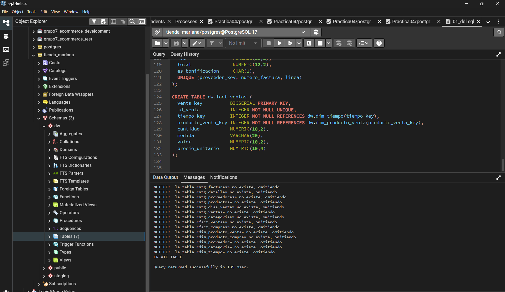
</p>
<p align="center"><b>Fig. 1.</b> Creación de los esquemas y tablas con sql/01_ddl.sql en pgAdmin.</p>

<a id="mod-especiales"></a>

### C. Registros especiales (−1)

Antes de cada carga, [`sql/02_reiniciar_dw.sql`](sql/02_reiniciar_dw.sql) vacía las tablas del DW con `TRUNCATE ... RESTART IDENTITY` e inserta un registro −1 ("Desconocido") en cada dimensión. Durante la carga de los hechos, si una búsqueda de clave no encuentra correspondencia, se asigna −1 para preservar la integridad referencial.

```sql
TRUNCATE TABLE dw.fact_compras, dw.fact_ventas, dw.dim_producto_compra,
  dw.dim_producto_venta, dw.dim_proveedor, dw.dim_categoria, dw.dim_tiempo
  RESTART IDENTITY;

INSERT INTO dw.dim_tiempo VALUES (-1, '1900-01-01', 0, 0, 0, 'Desconocido', 0, 0, 'Desconocido', 'N');
INSERT INTO dw.dim_categoria (categoria_key, id_categoria, nombre_categoria, aparece_en)
  VALUES (-1, -1, 'Desconocida', 'N/A');
```

<a id="fig-reiniciar"></a>
<p align="center">
  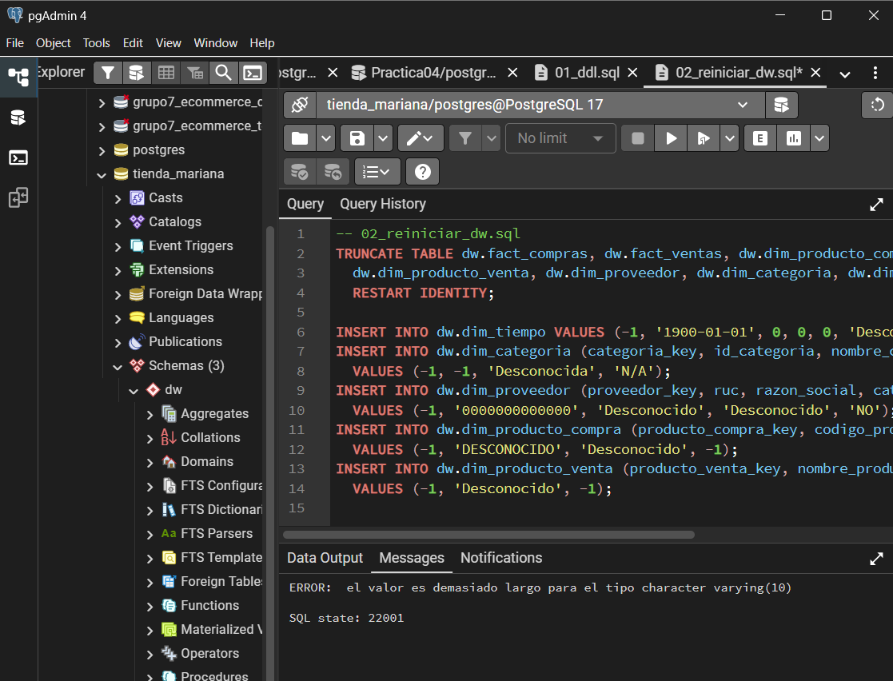
</p>
<p align="center"><b>Fig. 2.</b> Ejecución de sql/02_reiniciar_dw.sql: vaciado de tablas e inserción de los registros −1.</p>

<a id="mod-diagrama"></a>

### D. Diagrama del modelo

<a id="fig-diagrama"></a>
<p align="center">
  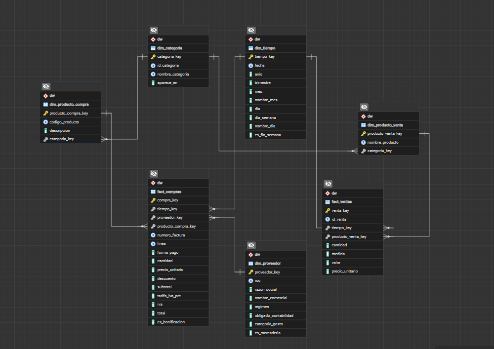
</p>
<p align="center"><b>Fig. 3.</b> Diagrama entidad-relación del esquema dw generado desde pgAdmin (ERD Tool).</p>

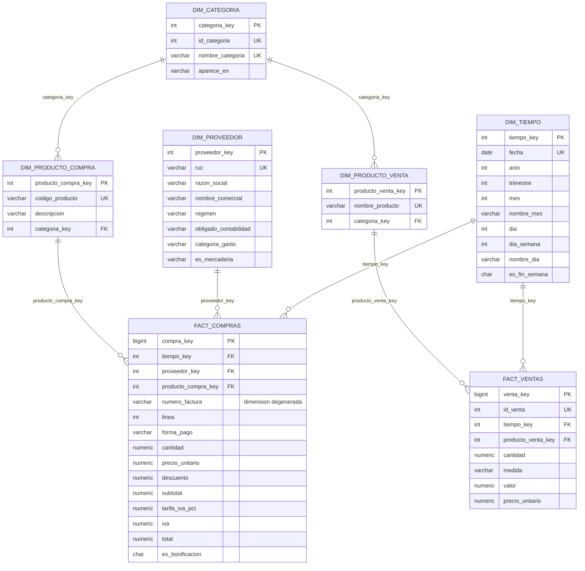

<a id="fig-mermaid"></a>
<p align="center"><b>Fig. 4.</b> Modelo constelación en Mermaid: dos hechos, dimensiones compartidas y copo de nieve parcial en categoría.</p>

---

<a id="etl"></a>

## VI. Proceso ETL en Pentaho

<a id="etl-arquitectura"></a>

### A. Arquitectura y conexión

El flujo es: **Excel (transcripción de facturas y ventas) → Pentaho PDI → esquema `staging` → esquema `dw` en PostgreSQL**. Cada paso es una transformación (`.ktr`) y un Job las orquesta. Todas se conectan mediante la conexión `conn_mariana` (PostgreSQL, `localhost:5432`, base `tienda_mariana`, acceso nativo JDBC). Los archivos están en [`pentaho/`](pentaho/).

<a id="tab-herramientas"></a>
<p align="center"><b>TABLE IX</b><br>HERRAMIENTAS Y VERSIONES</p>

| Herramienta | Versión | Uso |
|---|---|---|
| PostgreSQL | 17 | Base de datos del modelo dimensional |
| pgAdmin | — | Administración y ejecución de consultas |
| Pentaho Data Integration (PDI) | 10.2.0.0-222 | Proceso ETL |
| Power BI Desktop | — | Dashboard |
| Excel | — | Transcripción de las facturas y registro de ventas |

<a id="fig-conexion"></a>
<p align="center">
  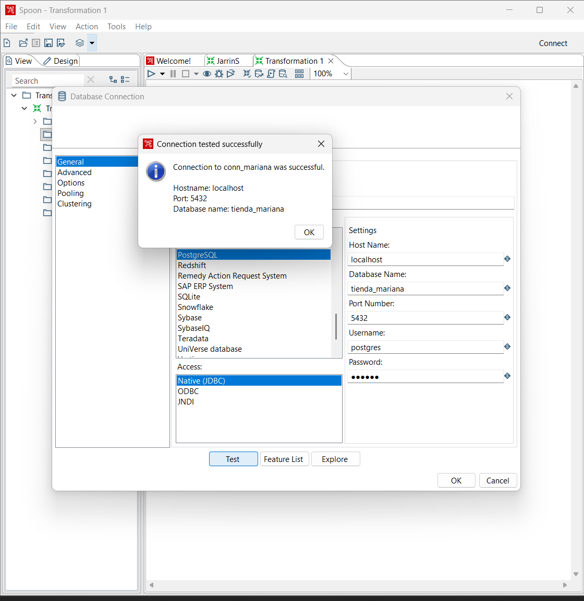
</p>
<p align="center"><b>Fig. 5.</b> Prueba exitosa de la conexión conn_mariana entre Pentaho y PostgreSQL.</p>

<a id="tab-transformaciones"></a>
<p align="center"><b>TABLE X</b><br>RESUMEN DE TRANSFORMACIONES DEL ETL</p>

| N.º | Transformación | Lee de | Escribe en | Filas escritas |
|---|---|---|---|---:|
| 01 | `01_staging.ktr` | Excel (7 hojas) | 7 tablas `staging.stg_*` | 3.957 |
| 02 | `02_dim_tiempo.ktr` | Generador de filas | `dw.dim_tiempo` | 730 |
| 03 | `03_dim_categoria.ktr` | `stg_categorias` | `dw.dim_categoria` | 17 |
| 04 | `04_dim_proveedor.ktr` | `stg_proveedores` | `dw.dim_proveedor` | 47 |
| 05 | `05_dim_producto_compra.ktr` | `stg_productos` | `dw.dim_producto_compra` | 604 |
| 06 | `06_dim_producto_venta.ktr` | `stg_ventas` | `dw.dim_producto_venta` | 395 |
| 07 | `07_fact_compras.ktr` | `stg_detalle`, `stg_facturas` | `dw.fact_compras` | 1.448 |
| 08 | `08_fact_ventas.ktr` | `stg_ventas`, `stg_dias_venta` | `dw.fact_ventas` | 1.214 |

*Nota.* Las filas son las escritas según las métricas de ejecución de Pentaho; no incluyen los registros −1.

<a id="etl-staging"></a>

### B. Staging: 01_staging

La transformación lee las siete hojas del Excel con pasos *Excel input* y las carga con *Table output* a siete tablas `staging.stg_*`, con opción de truncar la tabla antes de cargar. Dos pasos *Select values* renombran columnas de *Ventas* y de *Días venta*. Las rutas del archivo de origen se configuraron de forma relativa para que el repositorio sea reproducible (ver Anexo B).

<a id="fig-ejstaging"></a>
<p align="center">
  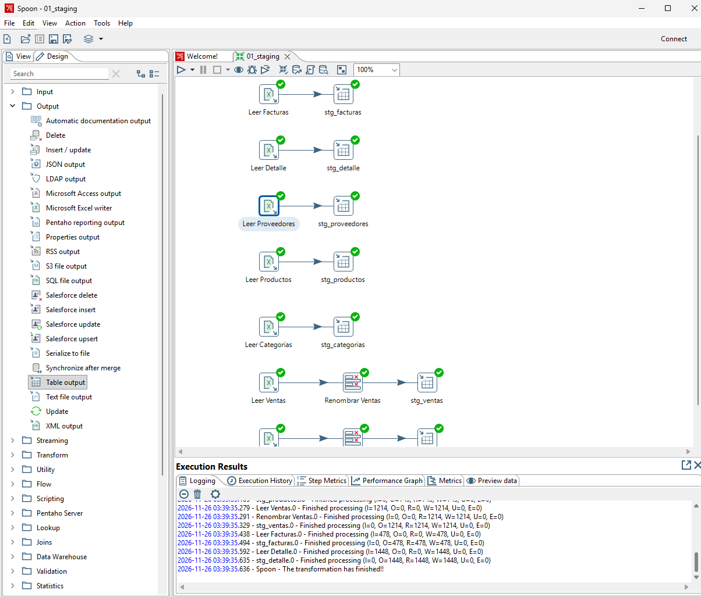
</p>
<p align="center"><b>Fig. 6.</b> Ejecución de la transformación 01_staging en Spoon.</p>

<a id="fig-stgres"></a>
<p align="center">
  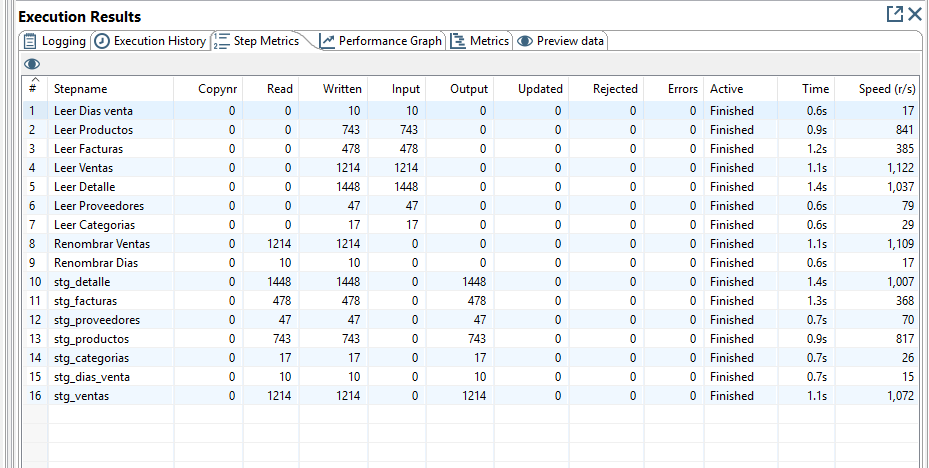
</p>
<p align="center"><b>Fig. 7.</b> Métricas de pasos de 01_staging: filas leídas y escritas por hoja (Días venta 10, Productos 743, Facturas 478, Ventas 1.214, Detalle 1.448, Proveedores 47, Categorías 17).</p>

<a id="etl-tiempo"></a>

### C. Dimensión tiempo: 02_dim_tiempo

Como la fuente no tiene una tabla de fechas, la dimensión se genera: un paso *Generar filas* produce 730 días a partir del 2025-01-01 (hasta 2026-12-31), *Calculator* obtiene año, trimestre, mes, día y día de la semana, y calcula la clave AAAAMMDD. Tres pasos *Value mapper* asignan el nombre del mes y del día en español y marcan como fin de semana el domingo (1) y el sábado (7).

<a id="fig-ejtiempo"></a>
<p align="center">
  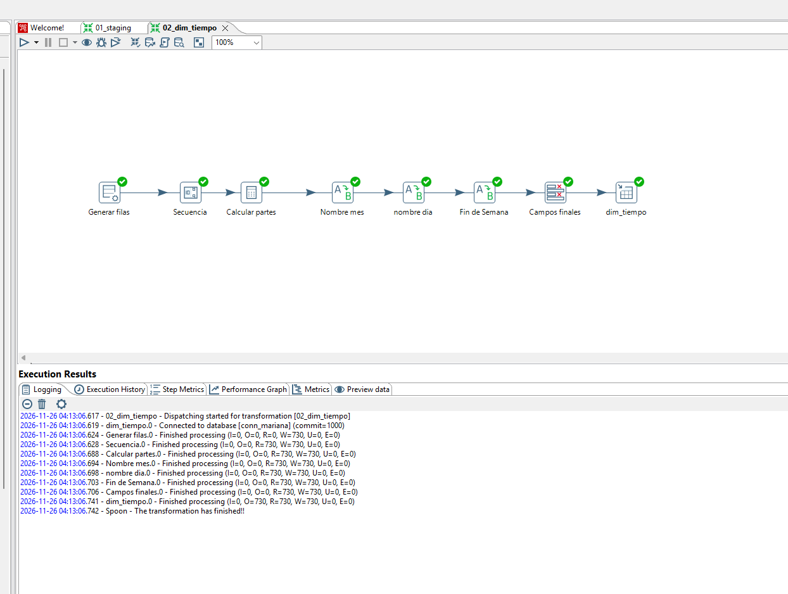
</p>
<p align="center"><b>Fig. 8.</b> Ejecución de la transformación 02_dim_tiempo.</p>

<a id="etl-categoria"></a>

### D. Dimensión categoría: 03_dim_categoria

Lee `staging.stg_categorias`, limpia el texto con *String operations* y carga `dw.dim_categoria` (17 categorías, más el registro −1).

<a id="fig-ejcategoria"></a>
<p align="center">
  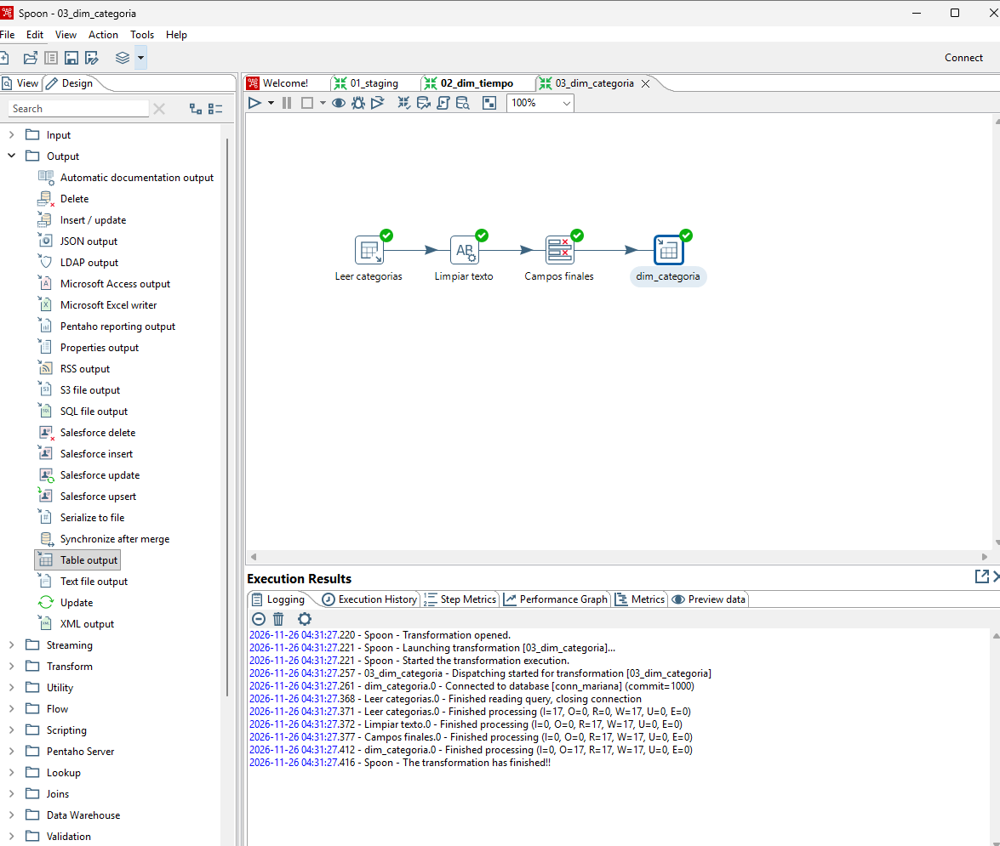
</p>
<p align="center"><b>Fig. 9.</b> Ejecución de la transformación 03_dim_categoria.</p>

<a id="etl-proveedor"></a>

### E. Dimensión proveedor: 04_dim_proveedor

Convierte el RUC a texto, recorta espacios en razón social, nombre comercial y categoría de gasto, pasa `es_mercaderia` a mayúsculas, ordena y elimina duplicados por RUC. En la ejecución entraron 47 filas y salieron 47, por lo que el control de duplicados fue preventivo.

<a id="fig-ejproveedor"></a>
<p align="center">
  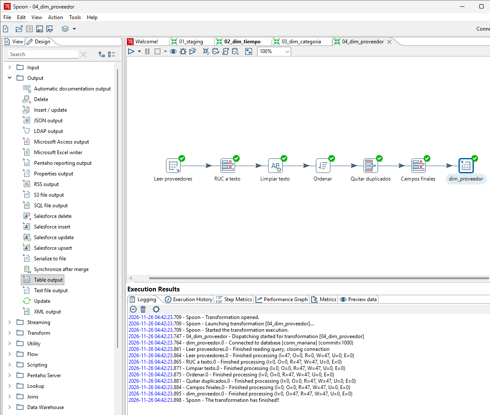
</p>
<p align="center"><b>Fig. 10.</b> Ejecución de la transformación 04_dim_proveedor (47 filas leídas y escritas).</p>

<a id="etl-prodcompra"></a>

### F. Dimensión producto de compra: 05_dim_producto_compra

Lee `staging.stg_productos`, limpia el texto, ordena y elimina duplicados por `codigo_producto`: de 743 filas quedan 604 productos únicos. Luego busca la categoría en `dim_categoria` y, si no la encuentra, asigna −1.

<a id="fig-ejprodcompra"></a>
<p align="center">
  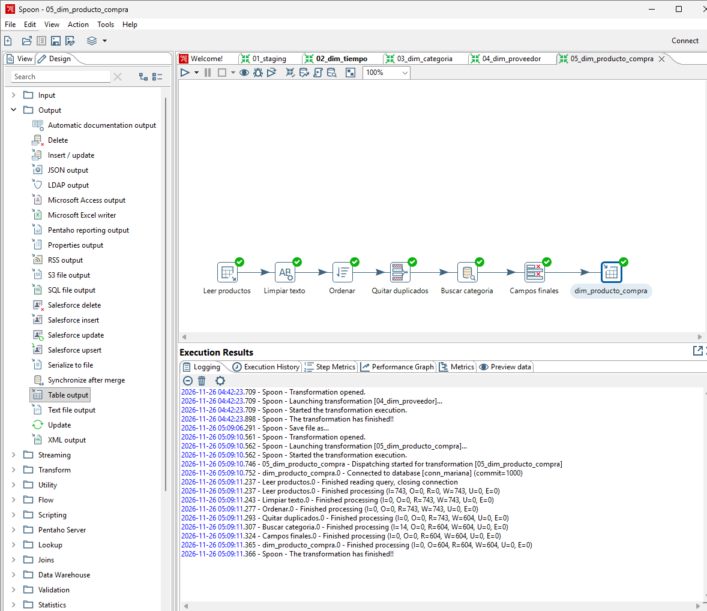
</p>
<p align="center"><b>Fig. 11.</b> Ejecución de la transformación 05_dim_producto_compra (743 filas leídas, 604 escritas).</p>

<a id="etl-prodventa"></a>

### G. Dimensión producto de venta: 06_dim_producto_venta

Toma `producto_normalizado` y `categoria` de `staging.stg_ventas`, elimina duplicados por producto normalizado (395 productos únicos) y busca la categoría con el mismo criterio de −1 si no existe.

<a id="fig-ejprodventa"></a>
<p align="center">
  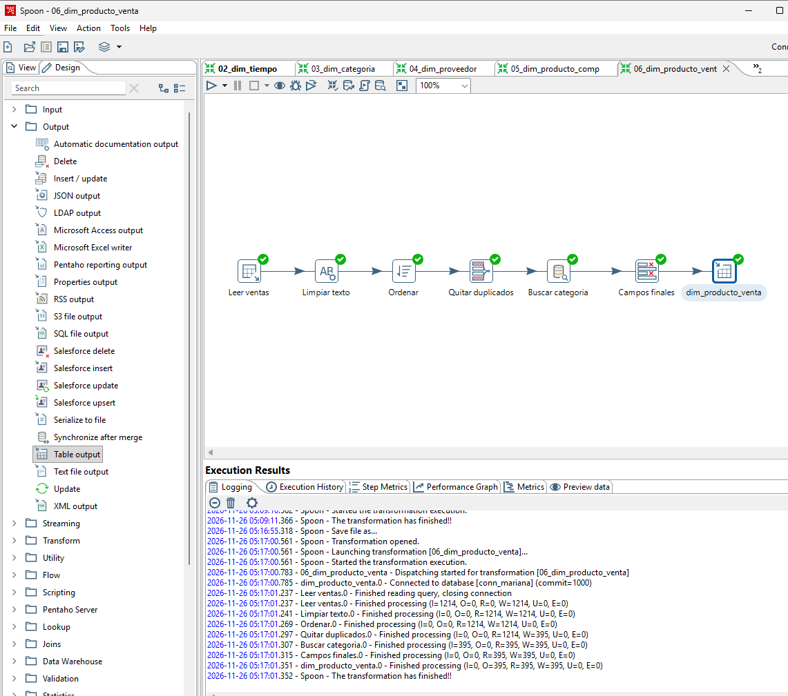
</p>
<p align="center"><b>Fig. 12.</b> Ejecución de la transformación 06_dim_producto_venta.</p>

<a id="etl-factcompras"></a>

### H. Hecho de compras: 07_fact_compras

Combina el detalle de las facturas con la forma de pago de la cabecera (*Stream lookup*), convierte el RUC a texto y aplica reglas de corrección en un paso *Janino* ([`pentaho/07_fact_compras.ktr`](pentaho/07_fact_compras.ktr)). Después busca las claves de tiempo, proveedor y producto (−1 si no hay correspondencia) y carga `dw.fact_compras` (1.448 filas).

```java
// Precio unitario: se recalcula si cantidad × precio − descuento difiere del subtotal en más de 0.05
(cantidad.doubleValue() > 0 && Math.abs(cantidad.doubleValue()*precio_unitario.doubleValue()
  - descuento.doubleValue() - subtotal_linea.doubleValue()) > 0.05)
  ? new Double((subtotal_linea.doubleValue() + descuento.doubleValue()) / cantidad.doubleValue())
  : precio_unitario

// Tarifa de IVA: 0.15 se convierte a 15
(tarifa_iva_pct.doubleValue() > 0 && tarifa_iva_pct.doubleValue() < 1)
  ? new Double(tarifa_iva_pct.doubleValue() * 100) : tarifa_iva_pct

// Bonificación: subtotal igual a cero
subtotal_linea.doubleValue() == 0 ? "S" : "N"
```

<a id="fig-ejfactcompras"></a>
<p align="center">
  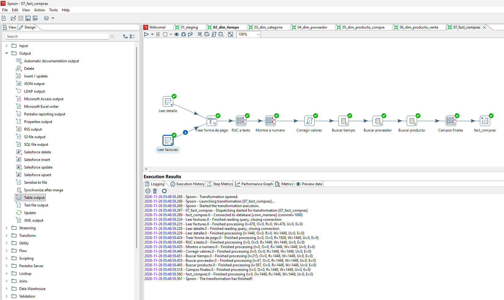
</p>
<p align="center"><b>Fig. 13.</b> Ejecución de la transformación 07_fact_compras.</p>

<a id="etl-factventas"></a>

### I. Hecho de ventas: 08_fact_ventas

Une cada venta con la fecha de su día de muestra, recorta y normaliza el texto, unifica las unidades de medida (`lib`→`libra`, `ramas`→`rama`, `fundas`→`funda`), reemplaza la medida vacía por "No informado" y la cantidad vacía por 1, convierte los guiones (`-` y `–`) en cantidad 1 y calcula el precio unitario. Finalmente busca las claves de tiempo y producto y carga `dw.fact_ventas` (1.214 filas) ([`pentaho/08_fact_ventas.ktr`](pentaho/08_fact_ventas.ktr)).

```java
// Precio unitario de la venta
cantidad.doubleValue() > 0 ? new Double(valor.doubleValue() / cantidad.doubleValue()) : new Double(0)
```

<a id="fig-ejfactventas"></a>
<p align="center">
  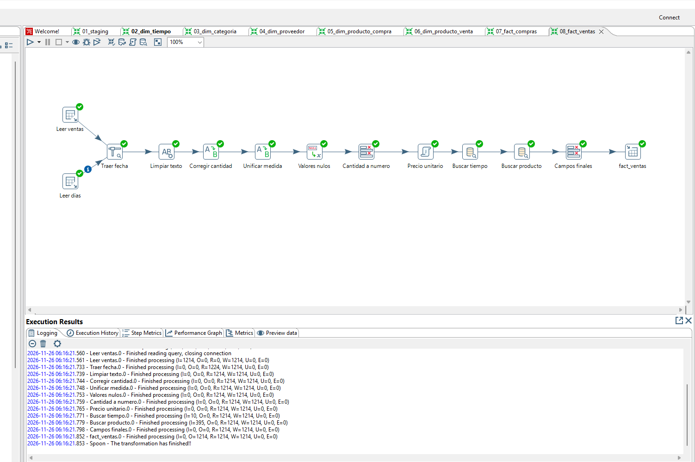
</p>
<p align="center"><b>Fig. 14.</b> Ejecución de la transformación 08_fact_ventas.</p>

<a id="etl-job"></a>

### J. Job orquestador

El Job [`Job_Tienda_Mariana.kjb`](pentaho/Job_Tienda_Mariana.kjb) ejecuta en secuencia: *Reiniciar DW* (SQL), `01_staging`, las cinco dimensiones y los dos hechos. Las dimensiones se cargan antes que los hechos porque los hechos buscan sus claves foráneas en ellas.

<a id="fig-job"></a>
<p align="center">
  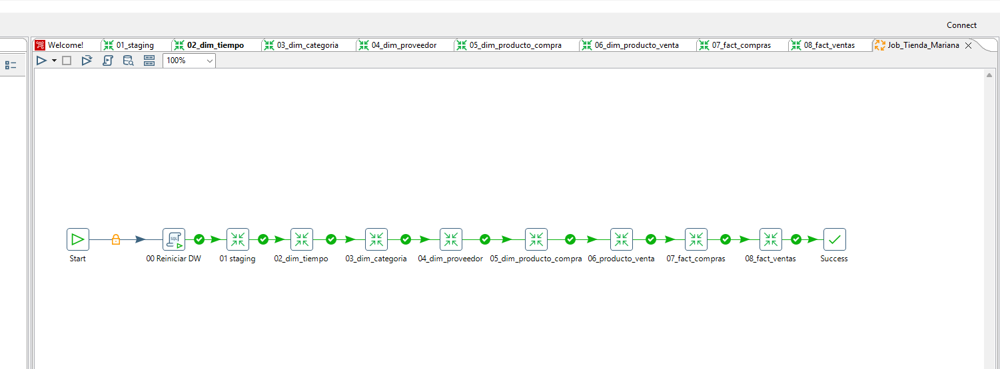
</p>
<p align="center"><b>Fig. 15.</b> Diseño del Job Job_Tienda_Mariana.</p>

<a id="fig-ejjob"></a>
<p align="center">
  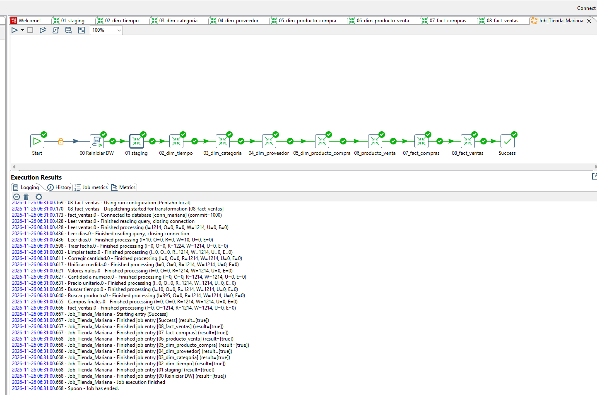
</p>
<p align="center"><b>Fig. 16.</b> Ejecución completa del Job: todos los pasos finalizan con éxito.</p>

<a id="etl-carga"></a>

### K. Estrategia de carga

El Job usa una **recarga completa**: en cada ejecución se truncan las tablas de staging y del DW y se cargan de nuevo todos los datos, es decir, una carga inicial (*initial load*) repetida [10]. Es adecuada para el volumen actual (1.448 compras y 1.214 ventas) y simplifica el control de calidad. Una **carga incremental** (*delta load*), que solo transfiere datos nuevos o modificados, sería la evolución natural si el negocio registrara facturas y ventas de forma continua.

<a id="etl-validacion"></a>

### L. Validación de la carga

Las validaciones están en [`sql/03_validacion.sql`](sql/03_validacion.sql). Los conteos del DW coinciden con los de staging, y ningún hecho apunta a un registro −1.

<a id="tab-validacion"></a>
<p align="center"><b>TABLE XI</b><br>CONTEO DE FILAS DEL DW TRAS LA CARGA</p>

| Tabla | Filas en el DW | Observación |
|---|---:|---|
| `dim_tiempo` | 731 | 730 fechas + registro −1 |
| `dim_categoria` | 18 | 17 + registro −1 |
| `dim_proveedor` | 48 | 47 + registro −1 |
| `dim_producto_compra` | 605 | 604 + registro −1 |
| `dim_producto_venta` | 396 | 395 + registro −1 |
| `fact_compras` | 1.448 | Igual a `stg_detalle` |
| `fact_ventas` | 1.214 | Igual a `stg_ventas` |
| Compras con clave −1 | 0 | Sin hechos huérfanos |
| Ventas con clave −1 | 0 | Sin hechos huérfanos |

```sql
SELECT 'dim_tiempo' tabla, COUNT(*) FROM dw.dim_tiempo
UNION ALL SELECT 'dim_categoria', COUNT(*) FROM dw.dim_categoria
UNION ALL SELECT 'fact_compras', COUNT(*) FROM dw.fact_compras
UNION ALL SELECT 'fact_ventas', COUNT(*) FROM dw.fact_ventas
UNION ALL SELECT 'compras con clave -1', COUNT(*) FROM dw.fact_compras
          WHERE tiempo_key = -1 OR proveedor_key = -1 OR producto_compra_key = -1
UNION ALL SELECT 'ventas con clave -1', COUNT(*) FROM dw.fact_ventas
          WHERE tiempo_key = -1 OR producto_venta_key = -1;
-- (se muestran las filas principales; el script completo está en sql/03_validacion.sql)
```

<a id="fig-val1"></a>
<p align="center">
  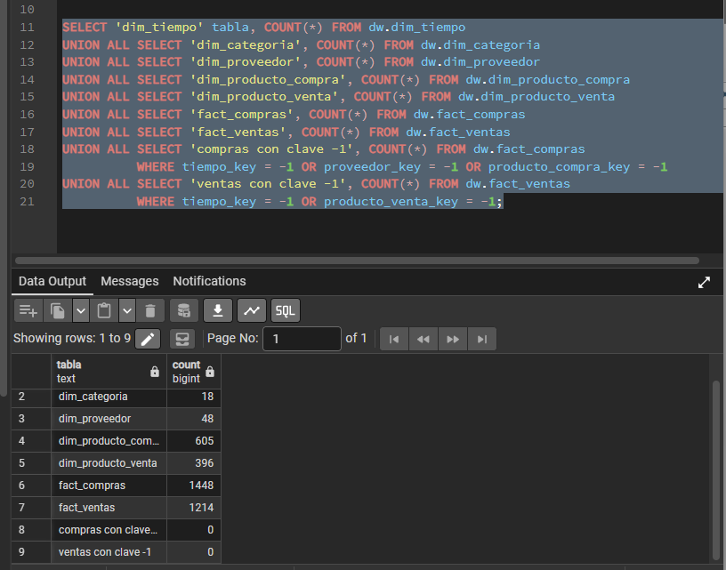
</p>
<p align="center"><b>Fig. 17.</b> Validación 1: conteo de filas de dimensiones y hechos, y hechos con clave −1.</p>

Las siguientes validaciones comprueban las reglas de limpieza aplicadas.

<a id="tab-reglas"></a>
<p align="center"><b>TABLE XII</b><br>VALIDACIÓN DE LAS REGLAS DE LIMPIEZA</p>

| Validación | Consulta | Resultado |
|---|---|---|
| Precio unitario máximo | `SELECT MAX(precio_unitario) FROM dw.fact_compras;` | 86,96 |
| Tarifas de IVA distintas | `SELECT DISTINCT tarifa_iva_pct FROM dw.fact_compras;` | 15,00 y 0,00 |
| Bonificaciones | `SELECT es_bonificacion, COUNT(*) FROM dw.fact_compras GROUP BY 1;` | N: 1.330; S: 118 |
| RUC con longitud distinta de 13 | `SELECT COUNT(*) FROM dw.dim_proveedor WHERE LENGTH(ruc) <> 13;` | 0 |

<a id="fig-val2"></a>
<p align="center">
  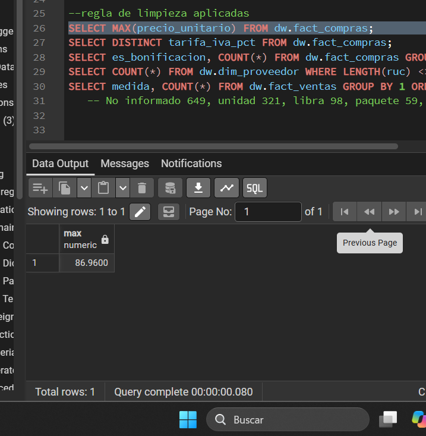
</p>
<p align="center"><b>Fig. 18.</b> Validación 2: precio unitario máximo en fact_compras tras la corrección.</p>

<a id="fig-val3"></a>
<p align="center">
  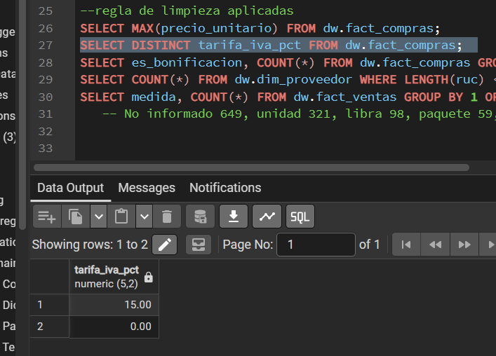
</p>
<p align="center"><b>Fig. 19.</b> Validación 3: las tarifas de IVA quedaron en una sola escala (15 y 0).</p>

<a id="fig-val4"></a>
<p align="center">
  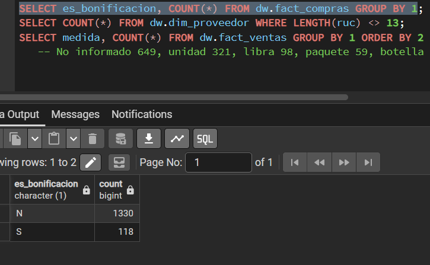
</p>
<p align="center"><b>Fig. 20.</b> Validación 4: líneas de compra marcadas como bonificación.</p>

<a id="fig-val5"></a>
<p align="center">
  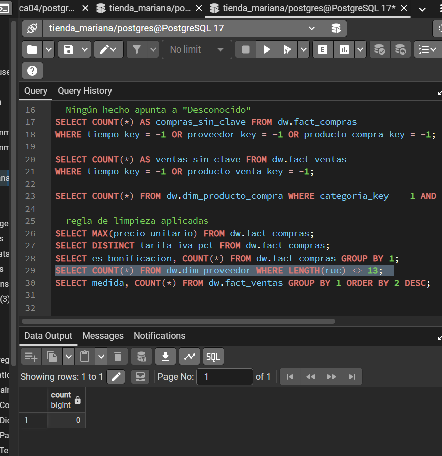
</p>
<p align="center"><b>Fig. 21.</b> Validación 5: ningún RUC con longitud distinta de 13 caracteres.</p>

---

<a id="problemas"></a>

## VII. Problemas encontrados

<a id="prob-datos"></a>

### A. En los datos

<a id="tab-probdatos"></a>
<p align="center"><b>TABLE XIII</b><br>PROBLEMAS ENCONTRADOS EN LOS DATOS Y TRATAMIENTO APLICADO</p>

| Problema | Evidencia | Tratamiento |
|---|---|---|
| Errores de digitación en precios (transcripción manual desde PDF) | Subtotal no coincidía con cantidad × precio − descuento | Se recalcula el precio unitario cuando la diferencia supera 0,05 (`07_fact_compras`) |
| Tarifa de IVA en escalas distintas (0,15 y 15) | Validación 3: solo quedan 15 y 0 | Los valores entre 0 y 1 se multiplican por 100 |
| Bonificaciones con valor cero | 118 de 1.448 líneas (8,1 %) con subtotal 0 | Se marcan con `es_bonificacion = 'S'` |
| RUC cargado como número | `ruc_proveedor` es `BIGINT` en staging; puede perder ceros iniciales | Se convierte a texto y se valida `LENGTH(ruc) = 13` (0 excepciones) |
| Productos de compra repetidos | 743 filas en staging, 604 códigos únicos | Eliminación de duplicados por `codigo_producto` |
| Productos sin categoría | Búsqueda de categoría sin coincidencia | Se asigna la categoría −1 ("Desconocida") |
| Cantidades de venta como texto, vacías o con guiones | Columna `cantidad` declarada `TEXT` en staging | Vacías y guiones (`-`, `–`) pasan a 1; luego se convierte a número |
| Unidades de medida escritas de varias formas | `lib`, `ramas`, `fundas` | Se unifican (`libra`, `rama`, `funda`) |
| Medida de venta no informada | 649 de 1.214 ventas (53,5 %) | Se reemplaza por "No informado" |
| Gastos que no son mercadería mezclados en las facturas | Servicios básicos, gasto personal, activo fijo y gasto administrativo (9,5 % del total) | Atributos `es_mercaderia` y `categoria_gasto` en `dim_proveedor` |
| Productos de venta con nombres escritos a mano | No existe una clave común con los productos de compra | Dimensión de producto separada; comparación por categoría |

<a id="prob-impl"></a>

### B. Durante la implementación

<a id="tab-probimpl"></a>
<p align="center"><b>TABLE XIV</b><br>PROBLEMAS ENCONTRADOS DURANTE LA IMPLEMENTACIÓN Y SOLUCIÓN</p>

| Problema | Solución |
|---|---|
| La fuente no tiene tabla de fechas | Se generó `dim_tiempo` en Pentaho: 730 días desde 2025-01-01, con clave AAAAMMDD y nombres en español |
| La columna `nombre_dia` no tenía longitud suficiente (por ejemplo, para "Desconocido") | Se amplió con `ALTER TABLE dw.dim_tiempo ALTER COLUMN nombre_dia TYPE VARCHAR(12)` |
| Hechos sin correspondencia en las dimensiones | Registros −1 insertados en `02_reiniciar_dw.sql` y valor por defecto −1 en las búsquedas |
| Orden de carga por claves foráneas | Las dimensiones se cargan antes que los hechos en el Job; el `TRUNCATE` incluye todas las tablas en una sola sentencia con `RESTART IDENTITY` |
| Datos duplicados al volver a ejecutar | Recarga completa: staging y DW se vacían en cada ejecución |
| Rutas absolutas del equipo en las transformaciones | Se cambiaron a rutas relativas para que el repositorio sea reproducible |
| No se puede publicar la fuente de datos | El Excel queda fuera del repositorio por protección de datos (Sección III-C) |

---

<a id="consultas"></a>

## VIII. Consultas SQL y respuestas

Las consultas están en [`sql/04_preguntas.sql`](sql/04_preguntas.sql). Cada una se muestra con su resultado y su respuesta. Las preguntas P4, P6 y P7 abarcan todas las facturas cargadas; P5 se analiza sobre 2025.

<a id="p1"></a>

### A. P1. Productos con más ingresos y más frecuencia de venta

```sql
SELECT p.nombre_producto,
       SUM(f.valor)  AS ingreso,
       COUNT(*)      AS veces_vendido
FROM dw.fact_ventas f
JOIN dw.dim_producto_venta p ON p.producto_venta_key = f.producto_venta_key
GROUP BY p.nombre_producto
ORDER BY ingreso DESC
LIMIT 10;
```

<a id="fig-p1"></a>
<p align="center">
  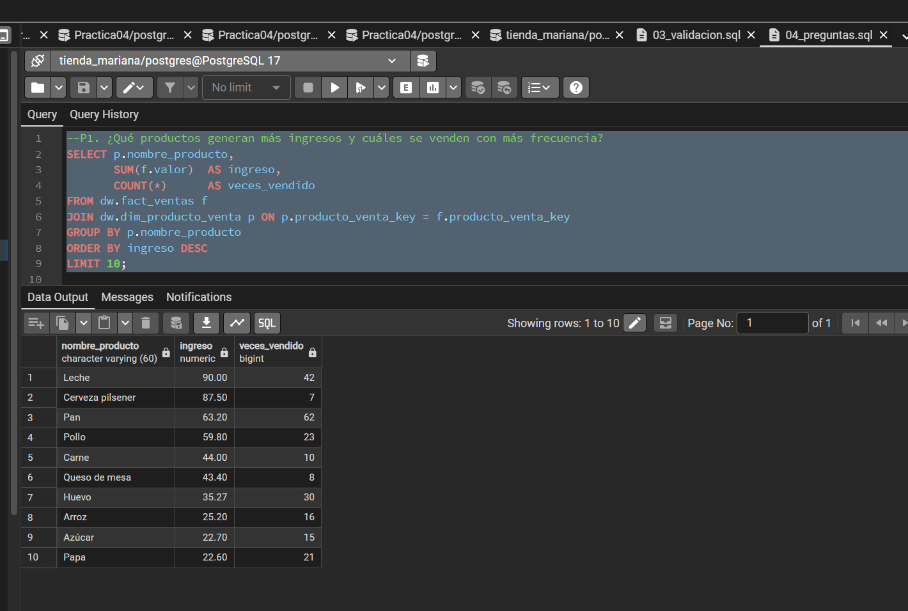
</p>
<p align="center"><b>Fig. 22.</b> Resultado de P1: diez productos con mayor ingreso en la muestra de ventas.</p>

<a id="tab-r1"></a>
<p align="center"><b>TABLE XV</b><br>P1. TOP 10 DE PRODUCTOS POR INGRESO</p>

| Producto | Ingreso (USD) | Veces vendido |
|---|---:|---:|
| Leche | 90,00 | 42 |
| Cerveza pilsener | 87,50 | 7 |
| Pan | 63,20 | 62 |
| Pollo | 59,80 | 23 |
| Carne | 44,00 | 10 |
| Queso de mesa | 43,40 | 8 |
| Huevo | 35,27 | 30 |
| Arroz | 25,20 | 16 |
| Azúcar | 22,70 | 15 |
| Papa | 22,60 | 21 |

**Respuesta.** La leche ($90,00) y la cerveza pilsener ($87,50) generan más ingresos. Sin embargo, la cerveza se vende pocas veces (7 registros, unos $12,50 por venta), mientras que el pan es el producto más frecuente (62 ventas) y la leche le sigue (42). Los ingresos dependen en unos casos del precio por venta (cerveza, carne, queso) y en otros de la frecuencia (pan, huevo, papa).

<a id="p2"></a>

### B. P2. Categorías que más aportan a las ventas

```sql
SELECT c.nombre_categoria,
       SUM(f.valor) AS ventas,
       ROUND(100 * SUM(f.valor) / SUM(SUM(f.valor)) OVER (), 1) AS pct
FROM dw.fact_ventas f
JOIN dw.dim_producto_venta p ON p.producto_venta_key = f.producto_venta_key
JOIN dw.dim_categoria c      ON c.categoria_key      = p.categoria_key
GROUP BY c.nombre_categoria
ORDER BY ventas DESC;
```

<a id="fig-p2"></a>
<p align="center">
  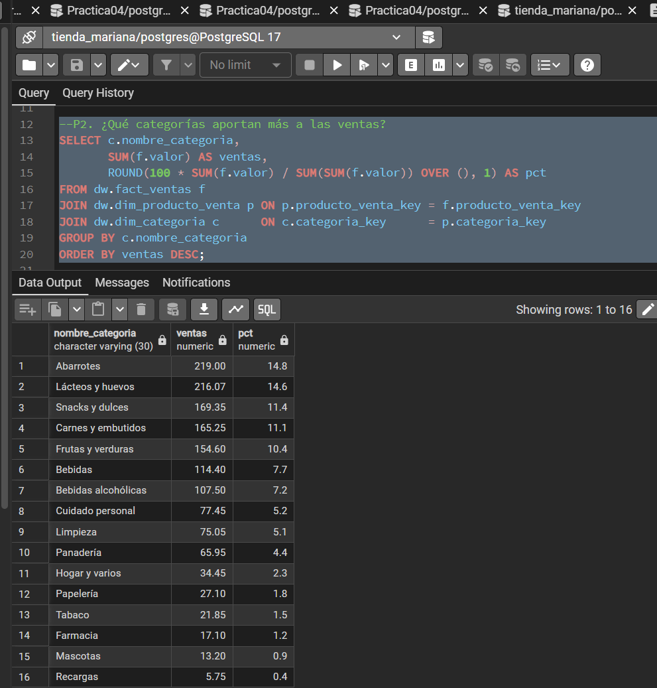
</p>
<p align="center"><b>Fig. 23.</b> Resultado de P2: ventas y participación porcentual por categoría (16 categorías).</p>

<a id="tab-r2"></a>
<p align="center"><b>TABLE XVI</b><br>P2. VENTAS POR CATEGORÍA (OCHO DE MAYOR APORTE)</p>

| Categoría | Ventas (USD) | % |
|---|---:|---:|
| Abarrotes | 219,00 | 14,8 |
| Lácteos y huevos | 216,07 | 14,6 |
| Snacks y dulces | 169,35 | 11,4 |
| Carnes y embutidos | 165,25 | 11,1 |
| Frutas y verduras | 154,60 | 10,4 |
| Bebidas | 114,40 | 7,7 |
| Bebidas alcohólicas | 107,50 | 7,2 |
| Cuidado personal | 77,45 | 5,2 |

**Respuesta.** Abarrotes (14,8 %) y Lácteos y huevos (14,6 %) son las categorías que más aportan. Las cinco primeras suman el 62,3 % de las ventas de la muestra, lo que muestra una distribución diversificada sin una categoría dominante.

<a id="p3"></a>

### C. P3. Ventas según el día de la semana

```sql
SELECT t.dia_semana, t.nombre_dia,
       COUNT(DISTINCT t.fecha) AS dias_registrados,
       SUM(f.valor) AS total,
       ROUND(SUM(f.valor) / COUNT(DISTINCT t.fecha), 2) AS promedio_diario
FROM dw.fact_ventas f
JOIN dw.dim_tiempo t ON t.tiempo_key = f.tiempo_key
GROUP BY t.dia_semana, t.nombre_dia
ORDER BY t.dia_semana;
```

<a id="fig-p3"></a>
<p align="center">
  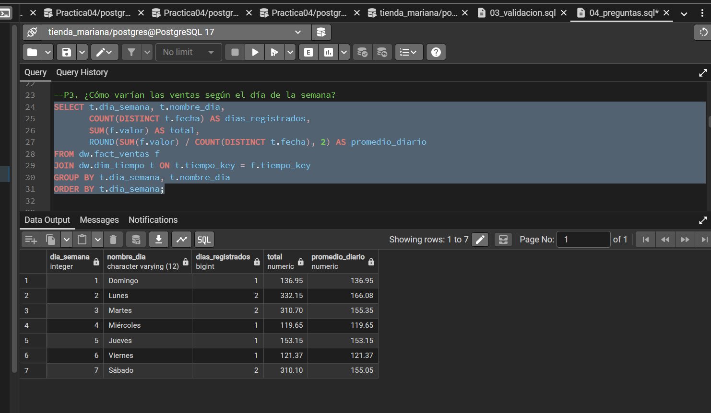
</p>
<p align="center"><b>Fig. 24.</b> Resultado de P3: total y promedio diario de ventas por día de la semana.</p>

<a id="tab-r3"></a>
<p align="center"><b>TABLE XVII</b><br>P3. VENTAS POR DÍA DE LA SEMANA</p>

| Día | Días registrados | Total (USD) | Promedio diario (USD) |
|---|---:|---:|---:|
| Domingo | 1 | 136,95 | 136,95 |
| Lunes | 2 | 332,15 | 166,08 |
| Martes | 2 | 310,70 | 155,35 |
| Miércoles | 1 | 119,65 | 119,65 |
| Jueves | 1 | 153,15 | 153,15 |
| Viernes | 1 | 121,37 | 121,37 |
| Sábado | 2 | 310,10 | 155,05 |

**Respuesta.** Como la muestra tiene entre uno y dos días por cada día de la semana, se comparan promedios diarios. El lunes tiene el mayor promedio ($166,08), seguido de martes, sábado y jueves (alrededor de $155), mientras que miércoles ($119,65) y viernes ($121,37) son los días más bajos. El lunes supera al miércoles en un 38,8 %. Con tan pocos días por categoría, el patrón es orientativo.

<a id="p4"></a>

### D. P4. Gasto por proveedor y concentración de compras

```sql
SELECT pr.razon_social,
       SUM(f.total) AS compras,
       ROUND(100 * SUM(f.total) / SUM(SUM(f.total)) OVER (), 1) AS pct
FROM dw.fact_compras f
JOIN dw.dim_proveedor pr ON pr.proveedor_key = f.proveedor_key
WHERE pr.es_mercaderia = 'SI'
GROUP BY pr.razon_social
ORDER BY compras DESC
LIMIT 10;
```

<a id="fig-p4"></a>
<p align="center">
  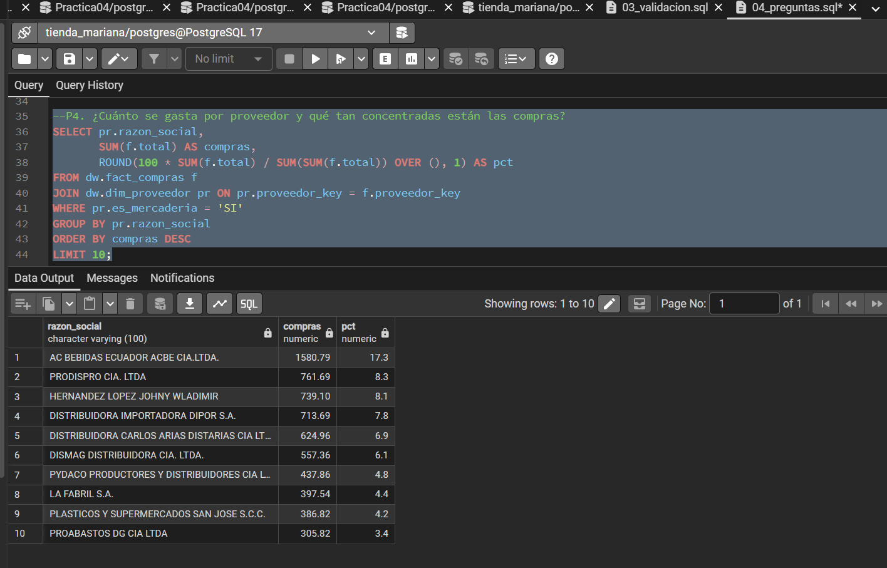
</p>
<p align="center"><b>Fig. 25.</b> Resultado de P4: diez principales proveedores de mercadería.</p>

<a id="tab-r4"></a>
<p align="center"><b>TABLE XVIII</b><br>P4. TOP 10 DE PROVEEDORES DE MERCADERÍA</p>

| Proveedor | Compras (USD) | % de la mercadería |
|---|---:|---:|
| AC Bebidas Ecuador ACBE Cía. Ltda. | 1.580,79 | 17,3 |
| Prodispro Cía. Ltda. | 761,69 | 8,3 |
| Hernández López Johny Wladimir | 739,10 | 8,1 |
| Distribuidora Importadora Dipor S.A. | 713,69 | 7,8 |
| Distribuidora Carlos Arias Distarias Cía. Ltda. | 624,96 | 6,9 |
| Dismag Distribuidora Cía. Ltda. | 557,36 | 6,1 |
| Pydaco Productores y Distribuidores Cía. Ltda. | 437,86 | 4,8 |
| La Fabril S.A. | 397,54 | 4,4 |
| Plásticos y Supermercados San José S.C.C. | 386,82 | 4,2 |
| Proabastos DG Cía. Ltda. | 305,82 | 3,4 |

**Respuesta.** Las compras de mercadería están concentradas: AC Bebidas Ecuador es el principal proveedor con $1.580,79 (17,3 %), más del doble que el segundo. Los tres primeros suman el 33,7 % y los diez primeros el 71,3 % de la mercadería.

<a id="p5"></a>

### E. P5. Evolución mensual de las compras (2025)

```sql
SELECT t.anio, t.mes, t.nombre_mes, SUM(f.total) AS compras
FROM dw.fact_compras f
JOIN dw.dim_tiempo t ON t.tiempo_key = f.tiempo_key
GROUP BY t.anio, t.mes, t.nombre_mes
ORDER BY t.anio, t.mes;
```

<a id="fig-p5"></a>
<p align="center">
  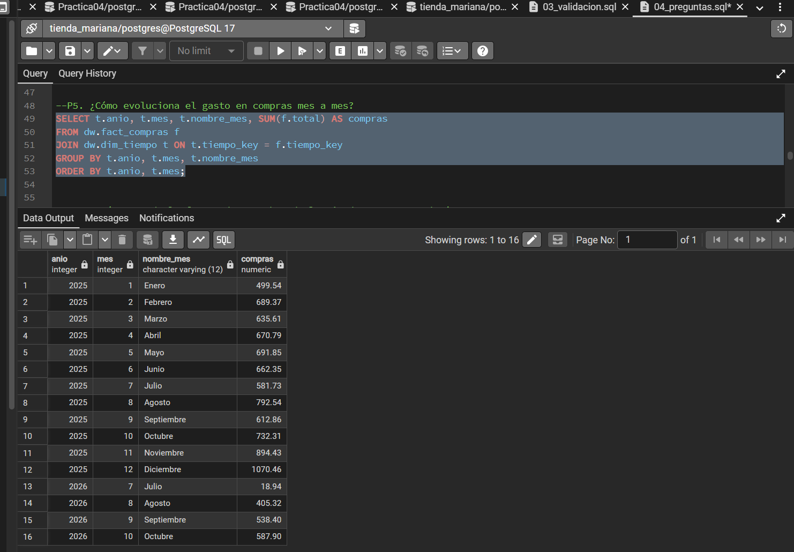
</p>
<p align="center"><b>Fig. 26.</b> Resultado de P5: compras mensuales.</p>

<a id="tab-r5"></a>
<p align="center"><b>TABLE XIX</b><br>P5. COMPRAS MENSUALES DE 2025</p>

| Mes | Compras (USD) |
|---|---:|
| Enero | 499,54 |
| Febrero | 689,37 |
| Marzo | 635,61 |
| Abril | 670,79 |
| Mayo | 691,85 |
| Junio | 662,35 |
| Julio | 581,73 |
| Agosto | 792,54 |
| Septiembre | 612,86 |
| Octubre | 732,31 |
| Noviembre | 894,43 |
| Diciembre | 1.070,46 |
| **Total 2025** | **8.533,84** |

**Respuesta.** En 2025 el gasto mensual se mantuvo estable entre febrero y julio (entre $580 y $690), con un pico en agosto ($792,54) y una caída en septiembre ($612,86). A partir de octubre crece de forma sostenida: $732,31, $894,43 y $1.070,46 en diciembre, el mes de mayor compra del año (50,5 % sobre el promedio mensual de $711,15). El cuarto trimestre ($2.697,20) concentra el 31,6 % del gasto anual.

<a id="p6"></a>

### F. P6. Parte de lo facturado que no es mercadería

```sql
SELECT pr.es_mercaderia, pr.categoria_gasto,
       SUM(f.total) AS total,
       ROUND(100 * SUM(f.total) / SUM(SUM(f.total)) OVER (), 1) AS pct
FROM dw.fact_compras f
JOIN dw.dim_proveedor pr ON pr.proveedor_key = f.proveedor_key
GROUP BY pr.es_mercaderia, pr.categoria_gasto
ORDER BY total DESC;
```

<a id="fig-p6"></a>
<p align="center">
  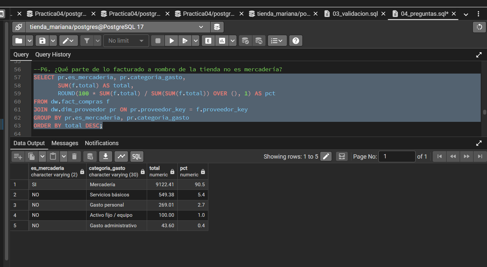
</p>
<p align="center"><b>Fig. 27.</b> Resultado de P6: composición del gasto facturado por categoría de gasto.</p>

<a id="tab-r6"></a>
<p align="center"><b>TABLE XX</b><br>P6. COMPOSICIÓN DE LO FACTURADO</p>

| ¿Mercadería? | Categoría de gasto | Total (USD) | % |
|:---:|---|---:|---:|
| SI | Mercadería | 9.122,41 | 90,5 |
| NO | Servicios básicos | 549,38 | 5,4 |
| NO | Gasto personal | 269,01 | 2,7 |
| NO | Activo fijo / equipo | 100,00 | 1,0 |
| NO | Gasto administrativo | 43,60 | 0,4 |

**Respuesta.** El 90,5 % de lo facturado es mercadería. El 9,5 % restante ($961,99) corresponde a gastos que no se revenden: servicios básicos (5,4 %), gasto personal (2,7 %), activo fijo o equipo (1,0 %) y gasto administrativo (0,4 %).

<a id="p7"></a>

### G. P7. Compras frente a ventas por categoría

```sql
WITH c AS (
  SELECT cat.nombre_categoria, SUM(f.total) AS compras
  FROM dw.fact_compras f
  JOIN dw.dim_producto_compra p ON p.producto_compra_key = f.producto_compra_key
  JOIN dw.dim_categoria cat     ON cat.categoria_key     = p.categoria_key
  WHERE cat.nombre_categoria <> 'No mercadería'
  GROUP BY cat.nombre_categoria
), v AS (
  SELECT cat.nombre_categoria, SUM(f.valor) AS ventas
  FROM dw.fact_ventas f
  JOIN dw.dim_producto_venta p ON p.producto_venta_key = f.producto_venta_key
  JOIN dw.dim_categoria cat    ON cat.categoria_key    = p.categoria_key
  GROUP BY cat.nombre_categoria
)
SELECT COALESCE(c.nombre_categoria, v.nombre_categoria) AS categoria,
       ROUND(100 * COALESCE(c.compras,0) / SUM(COALESCE(c.compras,0)) OVER (), 1) AS pct_compras,
       ROUND(100 * COALESCE(v.ventas,0)  / SUM(COALESCE(v.ventas,0))  OVER (), 1) AS pct_ventas
FROM c FULL JOIN v ON v.nombre_categoria = c.nombre_categoria
ORDER BY pct_compras DESC;
```

<a id="fig-p7"></a>
<p align="center">
  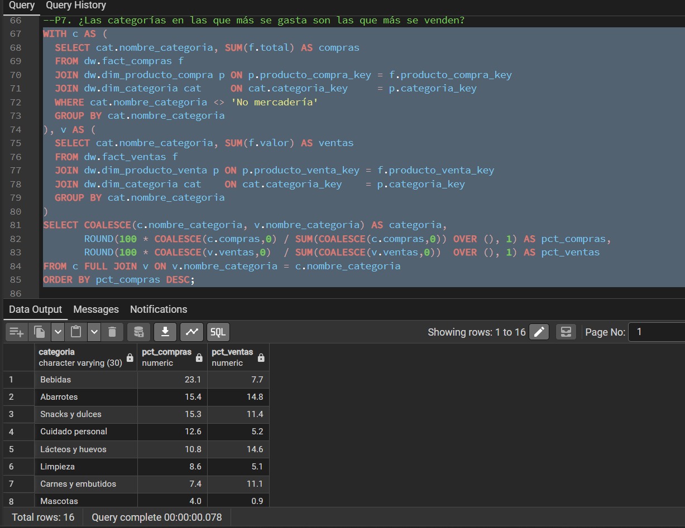
</p>
<p align="center"><b>Fig. 28.</b> Resultado de P7: porcentaje de compras y de ventas por categoría (16 filas; se muestran las primeras ocho).</p>

<a id="tab-r7"></a>
<p align="center"><b>TABLE XXI</b><br>P7. PARTICIPACIÓN EN COMPRAS Y EN VENTAS POR CATEGORÍA (PRIMERAS OCHO)</p>

| Categoría | % de compras | % de ventas |
|---|---:|---:|
| Bebidas | 23,1 | 7,7 |
| Abarrotes | 15,4 | 14,8 |
| Snacks y dulces | 15,3 | 11,4 |
| Cuidado personal | 12,6 | 5,2 |
| Lácteos y huevos | 10,8 | 14,6 |
| Limpieza | 8,6 | 5,1 |
| Carnes y embutidos | 7,4 | 11,1 |
| Mascotas | 4,0 | 0,9 |

**Respuesta.** No siempre. Abarrotes mantiene un equilibrio entre compras (15,4 %) y ventas (14,8 %). Bebidas y Cuidado personal pesan mucho más en las compras que en las ventas de la muestra (23,1 % frente a 7,7 %, y 12,6 % frente a 5,2 %). Lácteos y huevos y Carnes y embutidos ocurren al revés: venden más de lo que pesan en las compras facturadas. Como las ventas son una muestra de 10 días, la comparación es orientativa.

---

<a id="powerbi"></a>

## IX. Dashboard en Power BI

[enlace pendiente: dashboard de Power BI conectado a PostgreSQL]

Se desarrolló un dashboard de dos páginas en Power BI Desktop, conectado a la base `tienda_mariana` en PostgreSQL en modo Importar. Sigue las buenas prácticas de visualización del curso: titulares descriptivos, una jerarquía de lectura (indicadores, desglose y detalle), colores consistentes y gráficos adecuados a cada pregunta [4], [5], [10].

<a id="pbi-p1"></a>

### A. Página 1: Análisis de Facturas y Compras

Orientada al control financiero de las adquisiciones: monitorea la facturación, la concentración de proveedores, los impuestos y los descuentos. Una segmentación por año (2025 y 2026) permite segmentar la información y cuatro indicadores resumen la operación: **$10.084,40** en compras, **478** facturas, **$899,78** de IVA y **$524,44** en descuentos.

- **Top 10 Proveedores de Mercadería:** AC Bebidas Ecuador lidera con más de $1.500, seguido de Prodispro, Hernández López Johny Wladimir y Dipor (P4).
- **Evolución Mensual de Compras (2025):** comportamiento estable entre febrero y julio, repunte en agosto y crecimiento sostenido en el último trimestre hasta superar los $1.000 en diciembre (P5).
- **Mercadería vs. Gastos Operativos:** el 90,46 % ($9,12 mil) se destina a mercadería; servicios básicos representa el 5,45 % ($0,55 mil) y el resto corresponde a gasto personal, activo fijo y gasto administrativo (P6).
- **Resumen Financiero por Proveedor:** tabla de detalle de compras, descuentos e IVA por proveedor, útil para auditar de forma puntual.

<a id="fig-dash1"></a>
<p align="center">
  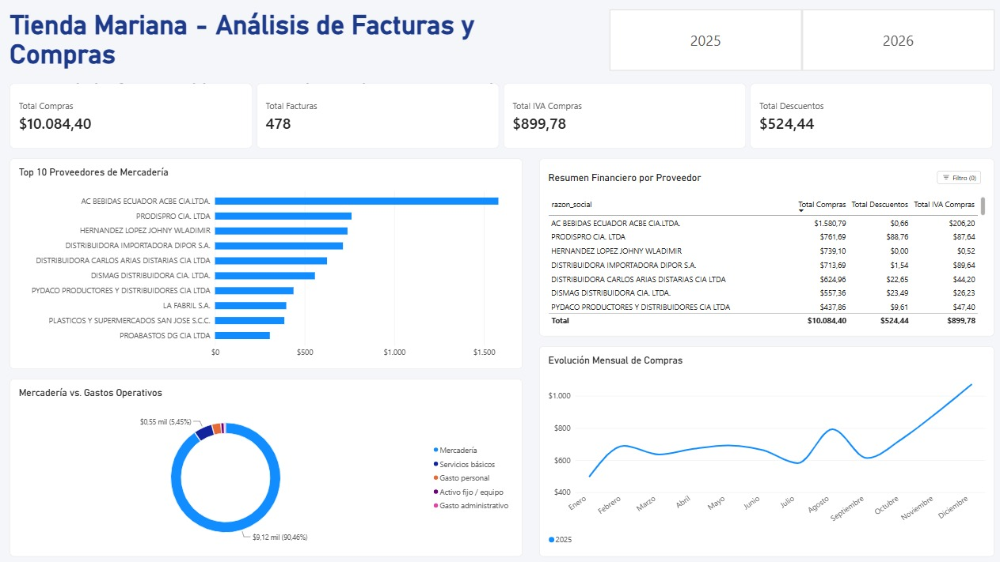
</p>
<p align="center"><b>Fig. 29.</b> Página 1 del dashboard: Análisis de Facturas y Compras.</p>

<a id="pbi-p2"></a>

### B. Página 2: Muestra de Ventas y Comparativa

Presenta el análisis comercial de la muestra de ventas y su cruce porcentual con las compras por categoría. Incluye el indicador **Total Ventas ($1.484,07)** y dos filtros: categoría (`nombre_categoria`) y día de la semana (`nombre_dia`).

- **Top 10 Productos por Ingresos:** lideran Leche y Cerveza pilsener (cercanos a $90), seguidos de Pan, Pollo, Carne y Queso de mesa (P1).
- **Participación de Ventas por Categoría:** Abarrotes ($219,00; 14,76 %), Lácteos y huevos ($216,07; 14,56 %), Snacks y dulces ($169,35; 11,41 %), Carnes y embutidos ($165,25; 11,13 %) y Frutas y verduras ($154,60; 10,42 %) (P2).
- **% Compras vs. % Ventas por Categoría:** contrasta el peso de cada categoría en las compras y en las ventas (P7). Es una comparación orientativa, porque las compras abarcan un periodo largo y las ventas son una muestra de 10 días.
- **Promedio Diario de Ventas por Día:** el lunes es el día de mayor ingreso (más de $160), seguido de martes, sábado y jueves (alrededor de $155); miércoles y viernes son los de menor movimiento (cerca de $120) (P3).

<a id="fig-dash2"></a>
<p align="center">
  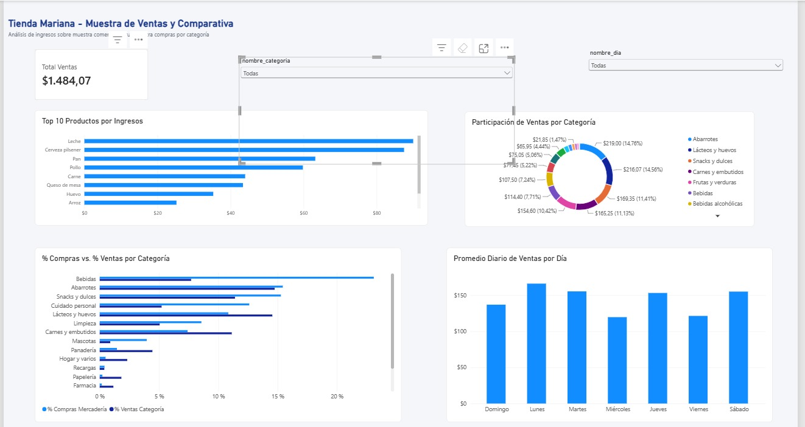
</p>
<p align="center"><b>Fig. 30.</b> Página 2 del dashboard: Muestra de Ventas y Comparativa.</p>

<a id="pbi-cobertura"></a>

### C. Cobertura de las preguntas de negocio

<a id="tab-cobertura"></a>
<p align="center"><b>TABLE XXII</b><br>VISUALES DEL DASHBOARD Y PREGUNTAS DE NEGOCIO QUE RESPONDEN</p>

| Pregunta | Visual del dashboard | Cobertura |
|---|---|---|
| P1 | Página 2: Top 10 Productos por Ingresos | Parcial: no muestra la frecuencia de venta (`veces_vendido`) |
| P2 | Página 2: Participación de Ventas por Categoría | Completa |
| P3 | Página 2: Promedio Diario de Ventas por Día | Completa |
| P4 | Página 1: Top 10 Proveedores de Mercadería | Parcial: no muestra el porcentaje de concentración |
| P5 | Página 1: Evolución Mensual de Compras (2025) | Completa |
| P6 | Página 1: Mercadería vs. Gastos Operativos | Completa |
| P7 | Página 2: % Compras vs. % Ventas por Categoría | Completa |

Los indicadores (KPI), la tabla por proveedor y la tarjeta Total Ventas son indicadores de apoyo que no responden por sí solos a ninguna de las siete preguntas. Como mejora, agregar etiquetas de datos a los gráficos de P1 y P4 permitiría cubrirlas por completo.

---

<a id="olap"></a>

## X. Análisis OLAP

[pendiente: análisis OLAP]

---

<a id="insights"></a>

## XI. Insights y recomendaciones

<a id="tab-insights"></a>
<p align="center"><b>TABLE XXIII</b><br>HALLAZGOS, EVIDENCIA Y RECOMENDACIONES</p>

| N.º | Hallazgo | Evidencia | Recomendación |
|---|---|---|---|
| 1 | El gasto en compras crece fuertemente hacia fin de año | Diciembre 2025: $1.070,46, un 114 % sobre enero y 50,5 % sobre el promedio mensual; el cuarto trimestre concentra el 31,6 % del gasto anual (P5) | Planificar el capital de trabajo y el inventario para el último trimestre y evaluar con las ventas si ese incremento se vende |
| 2 | Las compras de mercadería dependen de un proveedor | AC Bebidas Ecuador: 17,3 % de la mercadería; los diez primeros proveedores suman el 71,3 % (P4) | Negociar condiciones y descuentos con el proveedor principal y mantener alternativas para las categorías críticas |
| 3 | Bebidas y Cuidado personal pesan más en las compras que en las ventas | Bebidas: 23,1 % de las compras frente a 7,7 % de las ventas; Cuidado personal: 12,6 % frente a 5,2 % (P7) | Revisar rotación y niveles de stock de estas categorías antes de la siguiente compra |
| 4 | Lácteos y carnes venden más de lo que pesan en las compras facturadas | Lácteos y huevos: 14,6 % de ventas frente a 10,8 % de compras; Carnes y embutidos: 11,1 % frente a 7,4 % (P7) | Verificar el abastecimiento de estas categorías. Una posible explicación es que parte se compra en el mercado mayorista sin factura electrónica |
| 5 | Ingresos concentrados en pocos productos con comportamientos distintos | Leche y cerveza lideran en ingreso; el pan es el más frecuente (62 ventas) (P1) | Asegurar disponibilidad de los productos de alta frecuencia y cuidar el margen de los de alto valor por venta |
| 6 | Las ventas varían según el día | Lunes: $166,08 de promedio; miércoles: $119,65 (P3) | Reforzar el abastecimiento antes de los días fuertes y probar promociones en los días de menor venta |
| 7 | El 9,5 % de lo facturado no es mercadería | Servicios básicos: 5,4 %; gasto personal: 2,7 % (P6) | Separar los gastos del negocio de los personales en la facturación para medir mejor la rentabilidad |
| 8 | Las ventas no se registran de forma continua | Solo se dispone de una muestra de 10 días; no se registra la forma de pago | Registrar las ventas diariamente (producto, cantidad, medida y forma de pago: efectivo, DeUna o fiado) para analizar estacionalidad y fiado |

*Nota.* Las comparaciones entre compras y ventas son orientativas, porque las ventas provienen de una muestra de 10 días.

---

<a id="conclusiones"></a>

## XII. Conclusiones

- Se implementó una solución de Business Intelligence completa para un negocio real: un ETL en Pentaho que alimenta un modelo dimensional en PostgreSQL y un dashboard en Power BI, con 1.448 líneas de compra y 1.214 registros de venta cargados sin hechos huérfanos.
- El esquema constelación fue adecuado para dos procesos (compras y ventas) con granularidades distintas. Las dimensiones conformadas `dim_tiempo` y `dim_categoria` permitieron compararlos sin relacionar directamente las tablas de hechos.
- La calidad de datos fue el principal reto, por la transcripción manual desde PDF: precios, escalas de IVA, bonificaciones, unidades de medida y cantidades requirieron reglas de limpieza en el ETL.
- Los resultados muestran una compra de mercadería concentrada en un proveedor, un fuerte crecimiento del gasto hacia diciembre de 2025 y diferencias entre lo que se compra y lo que se vende por categoría.
- Los resultados de ventas son orientativos por provenir de una muestra de 10 días. Registrar las ventas de forma continua, incluyendo la forma de pago, es la mejora de mayor valor para el negocio.
- Como trabajo futuro se plantea la carga incremental, una dimensión basura para forma de pago y bonificación, una dimensión de producto conformada entre compras y ventas, y el análisis OLAP.

---

<a id="referencias"></a>

## Referencias bibliográficas

[1] R. Sherman, *Business Intelligence Guidebook: From Data Integration to Analytics*. Waltham, MA, EE. UU.: Morgan Kaufmann, 2015.

[2] R. Kimball y M. Ross, *The Data Warehouse Toolkit: The Definitive Guide to Dimensional Modeling*, 3.ª ed. Indianápolis, IN, EE. UU.: Wiley, 2013.

[3] W. H. Inmon, *Building the Data Warehouse*, 4.ª ed. Indianápolis, IN, EE. UU.: Wiley, 2005.

[4] C. N. Knaflic, *Storytelling with Data: A Data Visualization Guide for Business Professionals*. Hoboken, NJ, EE. UU.: Wiley, 2015.

[5] S. Few, *Information Dashboard Design: Displaying Data for At-a-Glance Monitoring*, 2.ª ed. Burlingame, CA, EE. UU.: Analytics Press, 2013.

[6] Hitachi Vantara, "Pentaho Data Integration 10.2," documentación oficial. [En línea]. Disponible en: https://docs.pentaho.com

[7] PostgreSQL Global Development Group, "PostgreSQL 17 Documentation." [En línea]. Disponible en: https://www.postgresql.org/docs/17/

[8] Microsoft, "Power BI Desktop documentation." [En línea]. Disponible en: https://learn.microsoft.com/power-bi/

[9] Asamblea Nacional del Ecuador, "Ley Orgánica de Protección de Datos Personales," *Registro Oficial*, Quinto Suplemento n.º 459, 26 de mayo de 2021.

[10] Escuela Politécnica Nacional, Facultad de Ingeniería de Sistemas, "Business Intelligence: material de clase (Clases 1 a 6)," periodo 2026-B.

---

<a id="ia"></a>

## Declaración de uso de inteligencia artificial

Se declara formalmente que el porcentaje de uso de herramientas de inteligencia artificial generativa en este proyecto ha sido del **20 %**. Se utilizaron **Claude** (Anthropic) y **Gemini** (Google) como apoyo para resolver dudas durante los procesos de transformación y para la estructuración, redacción, corrección de estilo y formato Markdown de este informe, incluida la redacción preliminar de la interpretación de resultados a partir de las capturas, que fue revisada por los integrantes. La implementación en PostgreSQL, el desarrollo del proceso ETL en Pentaho, la construcción del dashboard en Power BI, las capturas de pantalla y la resolución de los problemas encontrados son producto del trabajo de los integrantes del grupo.

---

<a id="anexos"></a>

## Anexos

<a id="anexo-a"></a>

### A. Estructura del repositorio

```text
bi_tienda_mariana/
├── README.md                 Informe final
├── img/                      Logos institucionales
│   ├── EPN_Escudo.png
│   └── FIS.png
├── pentaho/                  Proceso ETL
│   ├── 01_staging.ktr
│   ├── 02_dim_tiempo.ktr
│   ├── 03_dim_categoria.ktr
│   ├── 04_dim_proveedor.ktr
│   ├── 05_dim_producto_compra.ktr
│   ├── 06_dim_producto_venta.ktr
│   ├── 07_fact_compras.ktr
│   ├── 08_fact_ventas.ktr
│   └── Job_Tienda_Mariana.kjb
├── sql/
│   ├── 01_ddl.sql            Esquemas y tablas
│   ├── 02_reiniciar_dw.sql   Vaciado y registros -1
│   ├── 03_validacion.sql     Validación de la carga
│   ├── 04_preguntas.sql      Preguntas de negocio P1 a P7
│   └── 05_olap.sql           Consultas OLAP
└── capturas/                 Evidencias (ETL, validación, preguntas)
    ├── capturasOLAP/
    └── capturasPowerBi/
```

*Nota.* La carpeta `datos/` con el Excel de origen no se versiona por protección de datos.

<a id="anexo-b"></a>

### B. Cómo reproducir

1. Instalar PostgreSQL 17 y crear la base de datos `tienda_mariana`.
2. Ejecutar [`sql/01_ddl.sql`](sql/01_ddl.sql) para crear los esquemas `staging` y `dw` con sus tablas.
3. Instalar Pentaho Data Integration 10.2.0.0-222 y crear la conexión `conn_mariana` (PostgreSQL, `localhost:5432`, base `tienda_mariana`).
4. Colocar en la carpeta `datos/` un Excel con la misma estructura de siete hojas descrita en la [Sección III](#fuente) (el original no se publica) y verificar que la ruta relativa configurada en los pasos *Excel input* de `01_staging.ktr` apunte a ese archivo.
5. Abrir y ejecutar [`pentaho/Job_Tienda_Mariana.kjb`](pentaho/Job_Tienda_Mariana.kjb). El Job reinicia el DW, carga el staging, las dimensiones y los hechos.
6. Ejecutar [`sql/03_validacion.sql`](sql/03_validacion.sql) para validar la carga y [`sql/04_preguntas.sql`](sql/04_preguntas.sql) para obtener las respuestas a las preguntas de negocio.

<a id="anexo-c"></a>

### C. Integrantes

| Integrante | Rol |
|---|---|
| Guamán Maza Jonathan Steven | Integrante, Grupo F |
| Jarrin Román Helen Scarleth | Integrante, Grupo F |
| Maldonado Simbaña Shirley Estefani | Integrante, Grupo F |
| Sigcha Diaz Christian David | Integrante, Grupo F |

Docente: Diana Martínez · Business Intelligence · GR2SW · 2026-B